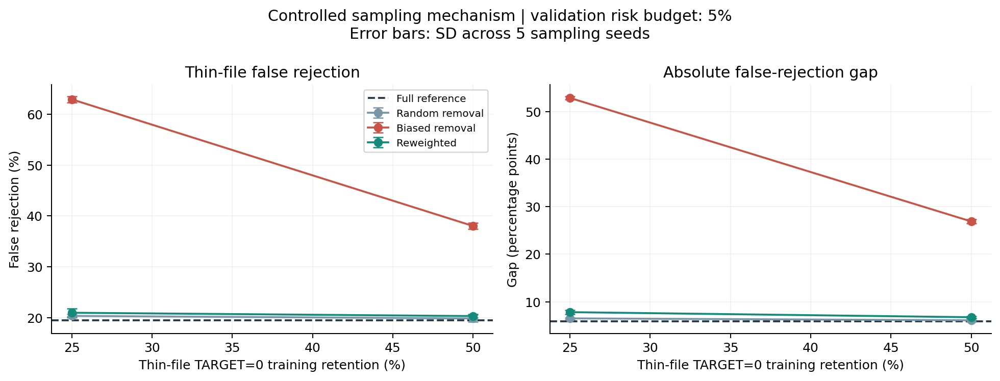
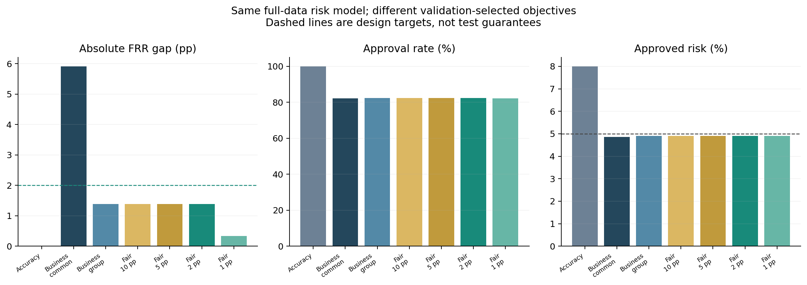
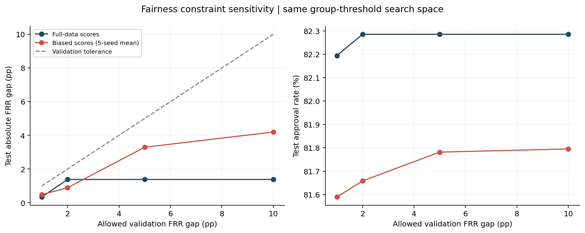
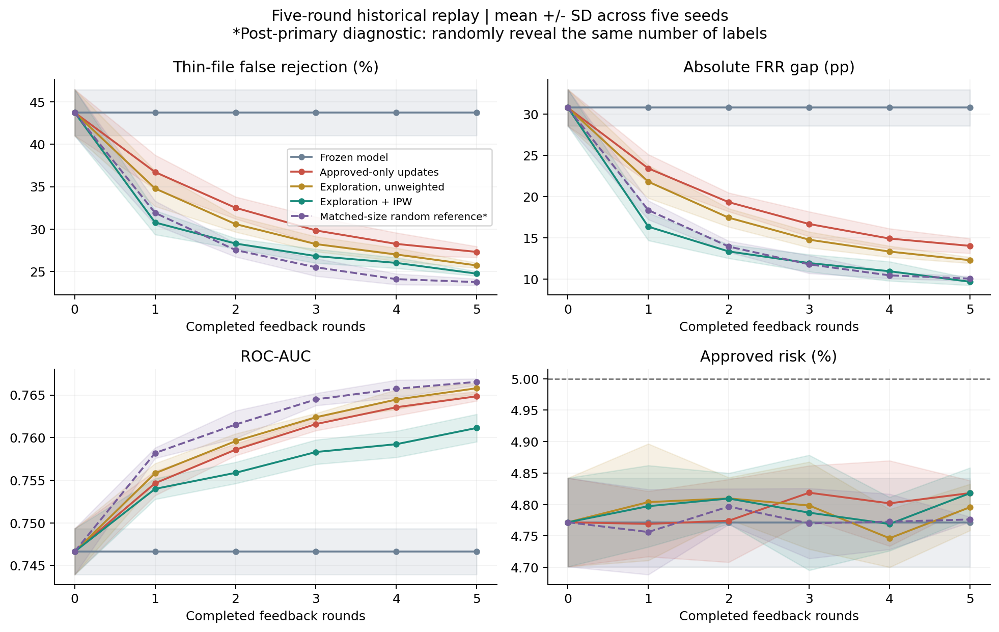
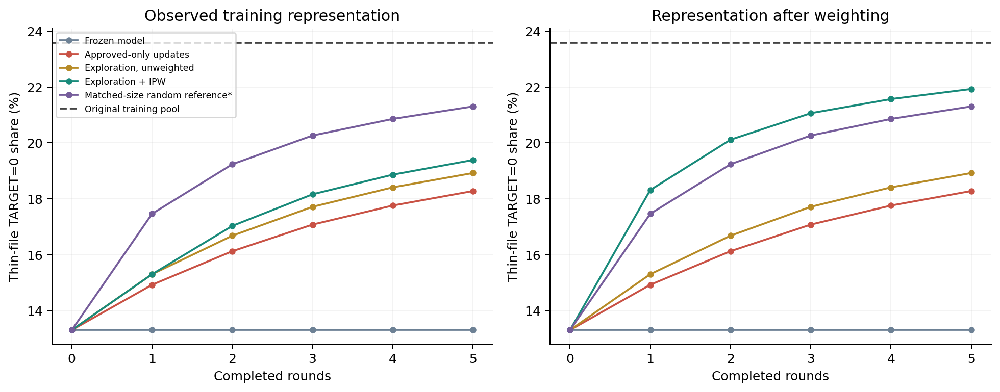
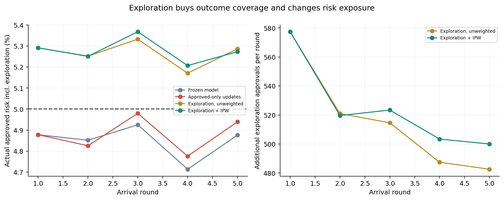
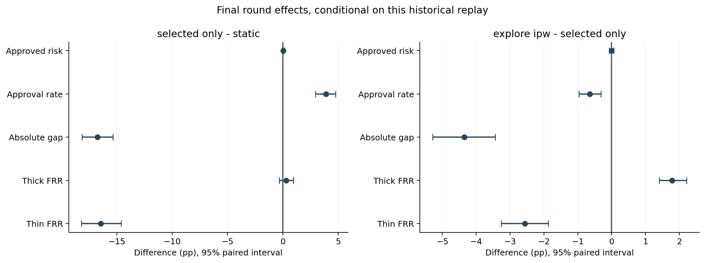

# 完整实验结果报告：数据、目标与反馈如何影响信贷机会

## 一、三问三答

| 问题 | 控制什么 | 实验回答 |
|---|---|---|
| 数据怎么来？ | 选择性采样与同规模随机删减 | 主实验加权纠正使薄弱组错拒率变化 -17.74 个百分点，恢复了大部分受控偏差造成的额外错拒 |
| 系统优化什么？ | 固定风险评分，改变审批目标及约束 | 完整模型的 2pp 约束未改变策略；五个偏置模型上差距由 4.20pp 降至 0.89pp，伴随获批率变化 |
| 系统如何更新？ | 只看获批反馈与探索/加权，多轮回放 | 未证实相对初始状态持续放大；但末轮仅获批反馈比同规模随机反馈多 3.56pp 薄弱组错拒，探索加权相对仅获批更新变化 -2.57pp |

**核心解释：**数据代表性、决策目标和标签可见性是不同机制。不能用一个公平指标的下降断言所有群体都受益，也不能把反馈循环的存在等同于偏差必然放大。

本报告涵盖 31 个原始采样对照模型、42 个审批策略对照、80 个预设反馈模拟模型及 25 个追加诊断模型。全部在本机 CPU、4 线程运行。新增主模块耗时 461.3 秒，追加诊断 148.4 秒（不含 bootstrap、制图和核验）。

## 二、共同背景与数据边界

使用 Home Credit 的 307,511 条有标签申请和 1,716,428 条征信记录，通过固定版本的第三方 GitHub 镜像获取，完整来源与哈希见 `data/raw/source.json`。镜像结构、标签数量和键已核验，但没有官方逐值比对。AWS 官方项目作为流程参考，本项目没有运行 SageMaker 云服务，也不代表银行生产审批模型。

薄弱组定义为申请前可观察征信记录 0—1 条，比较组至少 2 条；零记录可能来自覆盖不足。TARGET=1 表示前 Y 期中至少一期逾期超过 X 天，X/Y 未公开；“错拒”指 TARGET=0 客户被拒，并非保证这些客户永远不违约。

训练/参考/校准/验证/测试划分沿用 50/10/10/10/20%，各集合贷款记录 ID（SK_ID_CURR）不重叠；字段字典将其定义为贷款 ID，不能据此保证自然人或家庭不跨集合。模块 B 使用已训练模型的固定分数；模块 C 仅把原训练池拆成模拟初始历史和未来到达批次。原测试集在模块 A 已被查看，因此 B/C 是固定追加协议的后续机制分析，**不宣称全新外部盲测**。

### 审查后明确的结论边界

- 本项目采用相对于 TARGET 的群体机会准则；征信记录较少不自动等于受保护身份，FRR 差距本身不能证明不公平歧视。
- 模块 A 同时改变组内标签比例和群体人数，尚未分别识别纯粹人数不足与标签结构失真的贡献；纠正依赖代表性有标签参考集。
- 模块 C 始终有独立验证标签支持阈值选择，且假定每批结果已成熟后再更新，不能代表无外部验证支持或存在标签延迟的真实闭环。
- 这些范围限制及后续所需对照详见 [原则与逻辑审查](AUDIT_REPORT.md)。

## 三、模块 A：数据怎么来——采样不平衡与训练数据偏见

已有实验详细数值见 [模块 A 报告](RESULTS_REPORT.md)。主要设计是：仅删减薄弱组 TARGET=0，保留 50% / 25%，与相同人数随机删减对照，真实标签不变；用独立参考集的组别×标签联合比例估计纠正权重。

- 50% 保留率、5% 验证风险预算下，偏置模型薄弱组错拒率 38.03%，纠正后 20.29%。
- 获批者风险从 4.74% 变为 4.84%；比较组错拒也有变化，不能只谈受益群体。
- 数据偏见由实验人为设定；它说明这种机制可以造成不利差别，不能证明 Home Credit 实际按此机制采样。

## 四、模块 B：系统优化什么——固定模型，不同审批目标

### 4.1 设计与公式

固定预测概率 p，批准规则为 p≤t。准确率目标在验证集最小化误分类次数；业务目标在验证获批者风险≤5%下最大化批准人数。公平目标进一步约束两组 TARGET=0 错拒率绝对差距≤ε。

`max sum(approved)`，约束 `sum(TARGET * approved) <= 0.05 * sum(approved)`，公平策略另有 `abs(FRR_thin - FRR_thick) <= epsilon`。

统一阈值业务策略之外，加入**相同双阈值搜索空间但没有公平约束**的 `business_group`，因此公平目标的主比较是 fair_02−business_group。否则“分组阈值更灵活”与“加入公平约束”会混在一起。两种策略都在批准人数和风险完全相同时优先选择更小差距，因此此处比较的是增加公平硬约束的作用。每组网格最多约 514 个阈值，包含统一业务阈值；只宣称网格内最优，非连续全局最优。

这是审批后处理的目标函数实验，**没有改写 XGBoost 训练损失**，也不调用 Fairlearn 的随机化 ThresholdOptimizer。分组公平策略在决策时需要组别信息，是研究对照，不声称可直接上线。阈值均由验证集选择，之后固定用于测试。

### 4.2 完整数据模型上的测试结果

所有百分率列的单位为 %；差距列为百分点（pp）。

| 策略 | 分类准确率 | AUC | 薄弱组错拒 | 比较组错拒 | 绝对差距 | 获批率 | 获批风险 |
|---|---|---|---|---|---|---|---|
| 准确率目标 | 91.97 | 0.7717 | 0.06 | 0.05 | 0.00 | 99.86 | 7.99 |
| 业务：统一阈值 | 82.19 | 0.7717 | 19.42 | 13.51 | 5.91 | 82.11 | 4.87 |
| 业务：分组阈值 | 82.28 | 0.7717 | 15.91 | 14.53 | 1.38 | 82.29 | 4.91 |
| 公平：差距≤10pp | 82.28 | 0.7717 | 15.91 | 14.53 | 1.38 | 82.29 | 4.91 |
| 公平：差距≤5pp | 82.28 | 0.7717 | 15.91 | 14.53 | 1.38 | 82.29 | 4.91 |
| 公平：差距≤2pp | 82.28 | 0.7717 | 15.91 | 14.53 | 1.38 | 82.29 | 4.91 |
| 公平：差距≤1pp | 82.20 | 0.7717 | 15.23 | 14.89 | 0.34 | 82.19 | 4.91 |

注意所有策略 AUC 相同，因为底层风险排序相同；改变的是决策规则。高准确率本身没有表达业务风险预算或群体机会目标。公平约束并不保证风险、准确率、获批机会同时更好，必须结合整张表判断。

**这里有两个不能省略的发现：**准确率目标几乎批准全部申请，错拒差距接近零，但获批风险接近 8%，说明小差距本身不足以定义好策略。完整数据模型上，分组业务最优解已满足 2pp 验证容差，因此加上 2pp 约束后阈值和结果不变；不能把统一阈值到分组阈值的改善归功于公平约束。预设的更严格 1pp 约束才进一步把测试差距从 1.38pp 降到 0.34pp，获批率从 82.29% 变为 82.19%。

主公平策略的验证容差是 2pp，测试差距为 1.38pp。全部六个底层模型、四档公平约束共 24 个公平策略中，有 0 个测试差距超过各自验证容差；36 个带风险预算的策略中，有 0 个测试风险超过 5%。全部结果都保留；本次达标也不意味着未来一定达标。

### 4.3 偏置模型敏感性分析（五个种子均值）

| 策略 | 薄弱组错拒% | 比较组错拒% | 差距pp | 获批率% | 获批风险% |
|---|---|---|---|---|---|
| 准确率目标 | 0.48 | 0.04 | 0.44 | 99.69 | 7.93 |
| 业务：统一阈值 | 38.03 | 11.14 | 26.89 | 79.09 | 4.74 |
| 业务：分组阈值 | 18.46 | 14.26 | 4.20 | 81.80 | 4.85 |
| 公平：差距≤1pp | 15.78 | 15.47 | 0.48 | 81.59 | 4.85 |
| 公平：差距≤2pp | 15.77 | 15.39 | 0.89 | 81.66 | 4.86 |
| 公平：差距≤5pp | 17.80 | 14.51 | 3.29 | 81.78 | 4.85 |
| 公平：差距≤10pp | 18.46 | 14.26 | 4.20 | 81.80 | 4.85 |

在这些偏置模型上，2pp 公平约束相对同策略空间的业务对照更有约束作用。其获批率从 81.80% 变为 81.66%。这说明公平约束的作用依赖已有评分与群体风险分布，并非在所有模型上都会产生同样幅度的改变。

敏感性分析使用五个偏置模型，全部 42 行策略结果在 `results/extensions/objective/metrics.csv`。公平相对业务策略的配对区间在 `results/extensions/paired_intervals.csv`。

## 五、模块 C：系统如何更新——五轮反馈回放

### 5.1 模拟时间与标签可见性

每个种子把原训练池随机分成初始 20% 及五批新申请。初始历史仍对薄弱组 TARGET=0 保留 50%，四条路径共享同一初始偏置模型：静态不更新、只用获批反馈更新、10% 被拒客户随机探索后等权更新、同样探索后逆概率加权更新。

每轮用上轮模型先审批，只有常规获批和探索批准客户的标签才可见，轮末重训服务下一轮。这里假定该批还款观察窗口已经结束、标签已经成熟；模拟轮次不能对应未经验证的现实日历间隔。拒绝且未探索的结果在观测台账中留空，不能进入训练。探索获批的可见概率是 0.1，常规获批为 1；IPW 使用对应逆概率 10 或 1，归一化均值为 1。初始历史不做回溯修复，因此初始训练偏差不能被宣称一次消除。

所有路径都能使用固定独立校准和验证数据，逐轮校准和选择 5% 风险阈值；测试集从不用于调阈值。各路径对新批次的选择会不同，探索等权与加权不是在每一轮强制共享完全相同的训练记录，比较的是完整动态策略。每种子新增 16 个模型，共 80 个，固定 200 棵树、depth=5，不通过测试轨迹选轮次或调参。

这是历史数据回放：随机批次不是实际日期，还款结果沿用历史标签，假设不同审批路径不会改变个人潜在结果。真实部署时拒贷者结果不可知，探索意味着额外放贷才能获得反馈。该模拟只研究样本选择反馈，不模拟负债行为变化、宏观漂移或福利的长期因果效应。

**追加诊断的时间顺序：**看到预设四路径的轨迹后，我们发现“仅获批更新−静态”同时包含样本增长和选择机制两种变化，因此追加同规模随机反馈参照（详见 FEEDBACK_DIAGNOSTIC.md）。每轮随机获得与仅获批路径相同数量的标签，累计训练人数完全一致，初始模型和其他条件一致。它是理想化随机审计，不是可免费获得拒贷结果的部署策略；这是后续诊断，不冒充事前登记的主要检验。

### 5.2 末轮独立测试结果（五个种子均值）

| 路径 | AUC | 薄弱组错拒% | 比较组错拒% | 差距pp | 获批率% | 获批风险% |
|---|---|---|---|---|---|---|
| 静态不更新 | 0.7466 | 43.75 | 12.96 | 30.79 | 76.40 | 4.77 |
| 仅获批反馈 | 0.7648 | 27.30 | 13.27 | 14.04 | 80.29 | 4.82 |
| 随机探索，等权 | 0.7658 | 25.71 | 13.41 | 12.30 | 80.56 | 4.80 |
| 随机探索＋逆概率加权 | 0.7611 | 24.74 | 15.05 | 9.69 | 79.64 | 4.82 |
| 同规模随机反馈（追加诊断） | 0.7665 | 23.74 | 13.68 | 10.06 | 80.84 | 4.78 |

只用获批反馈更新，相对静态模型的薄弱组错拒率下降；本设定没有证实该指标的偏见放大。应继续查看群体差距、评分质量及风险，不能把反馈循环描述成必然恶化。

探索加权相对只用获批反馈的薄弱组错拒率更低，且在固定划分的条件 bootstrap 中，差值区间不跨零；这不是跨业务场景的显著性保证。

探索加权也有代价：末轮 AUC 从仅获批更新的 0.7648 变为 0.7611，总体获批率从 80.29% 变为 79.64%，比较组错拒率从 13.27% 变为 15.05%。因此它没有同时优化所有指标。

薄弱组错拒变化：仅获批更新−静态 = -16.44pp，近似 95% 区间 [-18.21, -14.61]；探索加权−仅获批更新 = -2.57pp，区间 [-3.26, -1.87]。

**同等标签数量的选择机制诊断：**末轮仅获批更新−随机反馈参照的薄弱组错拒差值为 +3.56pp，区间 [+2.97, +4.18]。这项比较更接近隔离标签选择方式；它与“相比初始状态是否改善”回答不同问题。不得因初始到末轮改善，就断言选择性反馈没有代价。

不能只比较末轮绝对差距：若两组同时更难获批，差距也可能缩小。表中同时展示两组错拒、总体批准和风险；轨迹保留所有轮次，而非选择最大改善的轮次。

### 5.3 探索并非没有代价

探索加权路径每个模拟种子五轮平均额外批准 2623.8 个原本被拒的申请。把探索批准也计入后，五轮实际批准的加权汇总观察风险为 **5.28%**。这与上表“常规审批策略在独立测试上的风险”不是同一口径；5% 的常规阈值预算不约束探索带来的额外风险。

记录 `stream_metrics.csv` 中的每轮风险、探索人数及薄弱组标签覆盖；训练权重有效样本量、最大权重在模型决策文件和 `test_metrics.csv` 中。IPW 的分布纠正与大权重导致的方差同时存在，不能只展示代表性改善。

### 5.4 末轮配对差值与不确定性

| 比较 | 指标 | 差值及95%区间（pp） |
|---|---|---|
| selected_only - static | 薄弱组错拒率 | -16.44 [-18.21, -14.61] |
| selected_only - static | 比较组错拒率 | +0.31 [-0.33, +0.97] |
| selected_only - static | 绝对错拒差距 | -16.75 [-18.16, -15.35] |
| selected_only - static | 总体获批率 | +3.89 [+2.96, +4.76] |
| selected_only - static | 获批风险 | +0.05 [-0.05, +0.13] |
| explore_unweighted - selected_only | 薄弱组错拒率 | -1.59 [-2.13, -1.03] |
| explore_unweighted - selected_only | 比较组错拒率 | +0.14 [-0.09, +0.37] |
| explore_unweighted - selected_only | 绝对错拒差距 | -1.74 [-2.26, -1.13] |
| explore_unweighted - selected_only | 总体获批率 | +0.27 [+0.05, +0.57] |
| explore_unweighted - selected_only | 获批风险 | -0.02 [-0.08, +0.04] |
| explore_ipw - selected_only | 薄弱组错拒率 | -2.57 [-3.26, -1.87] |
| explore_ipw - selected_only | 比较组错拒率 | +1.78 [+1.41, +2.22] |
| explore_ipw - selected_only | 绝对错拒差距 | -4.35 [-5.29, -3.43] |
| explore_ipw - selected_only | 总体获批率 | -0.64 [-0.96, -0.31] |
| explore_ipw - selected_only | 获批风险 | -0.00 [-0.07, +0.07] |
| explore_ipw - explore_unweighted | 薄弱组错拒率 | -0.97 [-1.38, -0.55] |
| explore_ipw - explore_unweighted | 比较组错拒率 | +1.64 [+1.36, +1.97] |
| explore_ipw - explore_unweighted | 绝对错拒差距 | -2.61 [-3.25, -2.01] |
| explore_ipw - explore_unweighted | 总体获批率 | -0.92 [-1.12, -0.72] |
| explore_ipw - explore_unweighted | 获批风险 | +0.02 [-0.05, +0.10] |
| selected_only - random_reference | 薄弱组错拒率 | +3.56 [+2.97, +4.18] |
| selected_only - random_reference | 比较组错拒率 | -0.41 [-0.74, -0.04] |
| selected_only - random_reference | 绝对错拒差距 | +3.97 [+3.19, +4.56] |
| selected_only - random_reference | 总体获批率 | -0.55 [-0.84, -0.26] |
| selected_only - random_reference | 获批风险 | +0.04 [-0.01, +0.10] |

配对 bootstrap 1000 次，同一测试贷款记录在所有模型中同步抽样，反馈比较还重采样五个模拟种子。区间条件于已固定的人群划分、校准/验证集及模拟参数，未覆盖真实时间变化或拒贷反事实的不确定性；多个辅助指标未作多重检验校正。

## 六、汇报结论怎么写

1. **数据来源机制会改变模型学到的风险关系。**选择性缺失某群体的正常还款案例，可增加该群体错拒；匹配机制的加权能够恢复部分表现。
2. **预测准确率、业务约束与公平目标表达不同的价值取舍。**同一评分模型可以产生不同审批结果；引入公平约束需要同时报告风险和各群体代价。
3. **审批决定会改变下一轮可以观察到的数据。**在独立验证集持续支持阈值选择、各批标签已成熟的设定下，本模拟没有发现薄弱组错拒随更新持续放大，但后续同规模诊断显示选择性反馈仍比随机反馈产生更多错拒。因此“模型比以前好”不代表反馈选择没有代价。探索和纠正可以改善信息覆盖，但有风险敞口、预测表现和群体机会取舍。

建议英文 PPT 使用 01（数据）、06（目标）、08（反馈）作为三张主图，10（探索成本）和11（置信区间）备答。可在云计算架构页展示：数据处理→训练→偏差审计→策略选择→反馈采集→下一轮训练；标注本次是 AWS-inspired 本地 CPU 验证，没有测量云端扩展性能。

## 七、复现、核验与资料

- 完整协议：`EXTENSION_PROTOCOL.md`；固定参数：`extensions_config.json`。
- 执行 `./run_complete.ps1`；新增程序 `src/extensions.py`，报告 `src/complete_report.py`，独立核验 `src/verify_extensions.py`。
- 核验记录：`results/extensions/verification.json`，检查阈值约束、测试指标重算、模拟新批次不重叠、先决策后观测、未观察标签不入训练、权重来源及静态对照一致性。
- 模块 A 原结果保持不变，完整复现环境见 README 和 requirements-lock.txt。
- [AWS 官方流程](https://github.com/aws-samples/amazon-sagemaker-credit-risk-prediction-explainability-bias-detection)
- [Fairlearn 官方信贷决策示例](https://fairlearn.org/v0.12/auto_examples/plot_credit_loan_decisions.html)
- [Selective Labels, KDD 2017](https://www.cs.cornell.edu/home/kleinber/kdd17-selective.pdf)
- [Delayed Impact of Fair Machine Learning, ICML 2018](https://proceedings.mlr.press/v80/liu18c.html)
