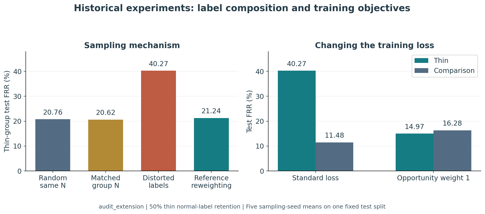
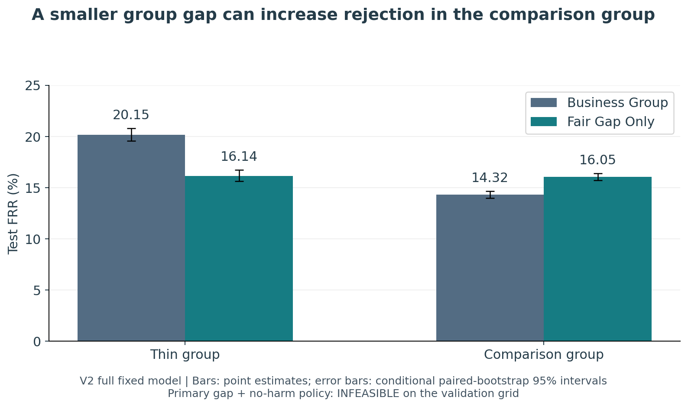
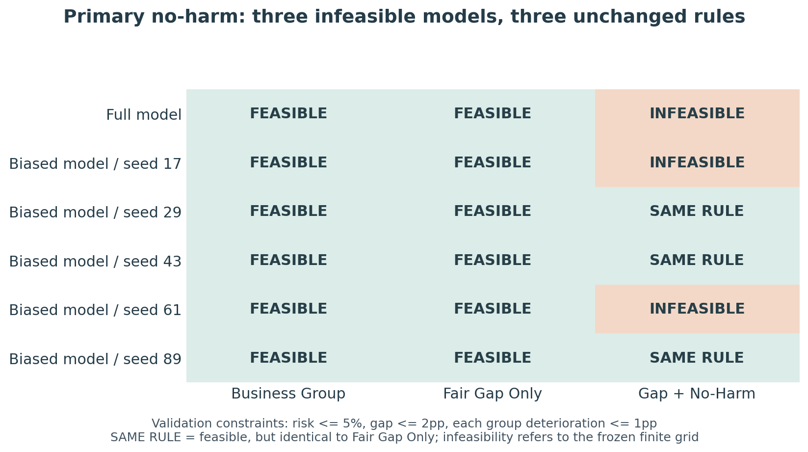
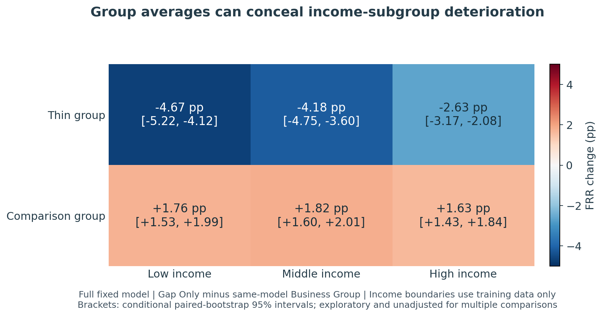
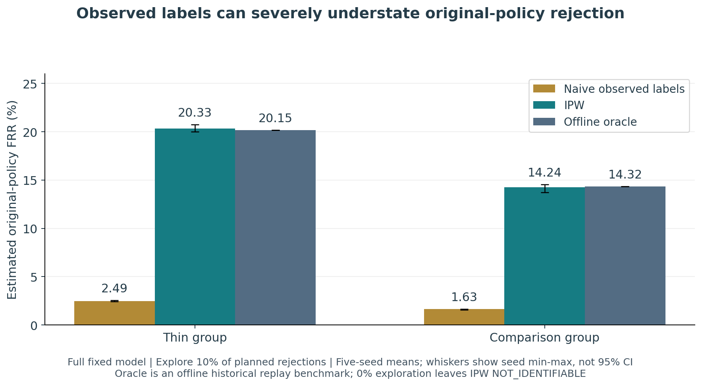
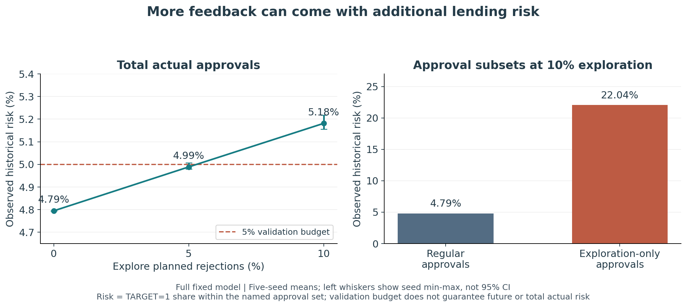
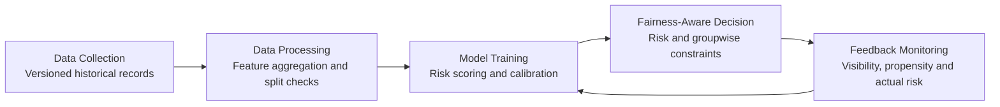

# 大数据算法歧视：贷款审批中的公平性与业务目标权衡

**云计算课程大作业 · 任务四：Algorithmic Discrimination in Big Data**

使用 Home Credit 历史贷款数据与 XGBoost 风险评分，研究：**一项公平干预帮助了谁、让谁承担了代价，以及这些影响能否被可靠地评价。**

> **先看结论：** 减小两个群体的错拒率差距，可能让另一组正常还款者更容易被拒；加入双侧保护后，部分模型找不到满足所有要求的审批规则。随机探索可以增加反馈信息，但也可能推高实际获批风险。
>
> 本项目是本地 CPU 上的受控历史数据实验，不代表银行生产系统，也不能据此认定真实机构存在违法歧视。

[英文 PPT](research_extension_v2/presentation/output/Fairness_Research_V2.pptx) · [英文讲稿](research_extension_v2/presentation/SPEAKER_NOTES_EN.md) · [中文实验报告](research_extension_v2/RESEARCH_EXTENSION_RESULTS.md) · [完整结果表](research_extension_v2/COMPARISON_TABLES.csv) · [复现说明](research_extension_v2/README.md)

## 阅读与汇报安排

沿用两部分、8 页、约 8 分钟的汇报结构。**这份中文图文稿用于理解和备课，不建议逐字照读；正式 PPT 页面使用英文。** 图中标题、坐标和图例均为英文，中文读图说明紧随图后。

| 部分 | 建议页次 | 内容 | 时间 |
|---|---:|---|---|
| 背景与现状调研 | 1 | 为什么预测准确还不够 | 0:00—0:40 |
| 背景与现状调研 | 2 | 偏见机制、分组和指标 | 0:40—1:35 |
| 背景与现状调研 | 3 | 文献依据与研究缺口 | 1:35—2:40 |
| 背景与现状调研 | 4 | 已有实验与问题来源 | 2:40—3:50 |
| 个人想法与可行解决方案 | 5 | 同模型下的双侧群体保护 | 3:50—4:55 |
| 个人想法与可行解决方案 | 6 | 实际效果与不可行结果 | 4:55—6:00 |
| 个人想法与可行解决方案 | 7 | 子群体、估计可靠性与探索成本 | 6:00—7:20 |
| 个人想法与可行解决方案 | 8 | 结论、局限与云计算联系 | 7:20—8:00 |

第 7 页材料较多，口头汇报建议重点展示 IPW 对照与探索后的风险数值；其余图可作为备答。上表是内容安排建议，最终时长需试讲确认，仓库中的现有英文 PPT 和讲稿可供排版与表达参考。

---

## 第一部分：背景与现状调研

### 第 1 页：为什么预测准确率高还不够？

贷款系统通常先预测还款困难的风险，再用审批规则决定是否放贷。**模型的总体预测表现较好，并不意味着不同群体获得贷款的机会都合理。**

例如，征信记录较少的人，如果在训练数据中缺少正常还款案例，可能得到偏高的风险评分。即使调整规则让两组结果接近，也仍需检查其他人是否因此承担了更多错拒。

本项目依次回答三个问题：

1. **数据和训练目标如何影响机会差异？**
2. **缩小群体差距时，能否限制每一组的额外损失？**
3. **只能看见部分还款结果时，评价是否可靠、获取信息要付出什么代价？**

**这一页的核心话：预测模型是否准确，与整个审批系统是否公平，是需要分别检查的问题。**

### 第 2 页：偏见可能出现在哪些环节？

| 环节 | 本项目检查的问题 | 需要区分的概念 |
|---|---|---|
| 数据采集与采样 | 某组正常还款案例被选择性遗漏 | 群体人数较少，与组内标签比例失真是不同变化 |
| 模型训练 | 训练损失更重视哪些记录和错误 | 机会导向损失是代理目标，不保证最终 FRR 相等 |
| 审批决策 | 如何在批准人数、风险和公平要求之间选择规则 | 公平差距变小，不一定意味着各组都改善 |
| 反馈更新 | 哪些申请人的还款标签可见 | 可见标签的组成受历史审批决定影响 |

**研究分组**根据时间检查后的可观察征信记录数量确定：

- **Thin-file，征信记录较少组：** `BUREAU_COUNT <= 1`，包括零条记录。
- **Comparison，比较组：** 至少两条可观察征信记录。

零记录可能反映数据覆盖不足。上述分组不自动代表贫困人口，也不等同于法律上的受保护身份。

**主要机会指标：错拒率（False Rejection Rate，FRR）**

$$
\mathrm{FRR}_g=P(\text{Reject}\mid Y=0,G=g).
$$

它表示：在某组历史标签为正常的记录中，有多少被当前规则拒绝。`TARGET=1` 表示历史还款困难，`TARGET=0` 表示其余正常标签；后者并不保证一个人永远不会违约。“错拒”是相对于这个历史标签的操作性定义。

| 指标 | 在本文中的含义 | 单位 |
|---|---|---|
| 群体 FRR | 该组历史正常标签记录中被拒绝的比例 | % |
| 绝对 FRR 差距 | 两组 FRR 的绝对差 | 百分点，pp |
| 获批率 | 所有记录中获得批准的比例 | % |
| 获批风险 | 获批记录中 `TARGET=1` 的比例 | %，不是损失金额 |
| AUC | 评分区分两类历史标签的排序能力 | 0—1 |

例如，FRR 从 14% 变为 16%，是**上升 2 个百分点**，不是上升 2%。

### 第 3 页：已有研究提供了什么思想？

| 研究方向 | 正式文献 | 对本项目的启发 |
|---|---|---|
| 机会准则与后处理 | Hardt 等，NeurIPS 2016 [1] | 用条件于有利历史标签的机会指标评价，并在评分后调整决策 |
| 公平性与业务目标联合优化 | Corbett-Davies 等，KDD 2017 [2]；Agarwal 等，ICML 2018 [3] | 把目标和约束写清楚，保留公平约束带来的业务代价与不可行情况 |
| 子群体公平性 | Kearns 等，ICML 2018 [4] | 粗群体的平均指标可能掩盖交叉子群体的不利变化 |
| 选择性标签 | Lakkaraju 等，KDD 2017 [5] | 决策影响标签是否可见，直接用可见数据评价可能产生偏差 |
| 决策学习与长期公平 | Kilbertus 等，AISTATS 2020 [6]；Valdrighi 等，ICML 2026 [7] | 将信息获取与决策后果纳入研究，不能把一次改善外推为长期公平保证 |

本项目借鉴这些思想，组合出可复现的阈值优化与审计流程；**没有声称完整复现公平分类归约、对抗式子群体学习或长期强化学习算法，也没有提出新的公平性理论。**

### 第 4 页：已有实验如何引出新问题？

数据包括 **307,511 条有标签贷款申请**和 **1,716,428 条征信记录**。训练、参考、校准、验证和测试按贷款记录划分为 **50% / 10% / 10% / 10% / 20%**。参考集用于分布纠正，校准集用于概率校准，验证集用于选审批规则，测试集用于冻结后的评价。

#### 图 1：正常案例遗漏与训练目标都会改变错拒



**如何读图：**

- **左图看数据机制。** 同组人数、保留组内标签比例的对照（Matched group N）中，薄弱组 FRR 为 **20.62%**；正常标签组成失真后为 **40.27%**。参考分布重加权后回到 **21.24%**。
- **右图看训练目标。** 有偏数据上，机会权重 1 使薄弱组 FRR 从 **40.27% 降至 14.97%**，同时使比较组从 **11.48% 升至 16.28%**；两组绝对差距从 **28.79pp 降至 1.30pp**。

**统计口径：** 此图来自历史 `audit_extension`，为 50% 薄弱组正常标签保留场景、五个采样种子的测试均值。同一个历史测试人群上的五个种子不是五个独立业务场景。左图包含同总人数随机对照；其中 Matched group N 与 Distorted labels 进一步匹配两组人数。

**结论边界：** 重加权依赖有代表性的有标签参考数据。机会权重 1 也并非处处有效：在完整训练数据上，历史差距从 **6.28pp 变为 7.40pp**。不能只保留有偏数据上的正面结果。

[采样结果来源](audit_extension/results/sampling_summary.csv) · [训练损失结果来源](audit_extension/results/loss_summary.csv) · [历史完整报告](audit_extension/RESULTS_REPORT.md)

**由此引出新问题：能否在限制业务风险、缩小群体差距的同时，也限制每一组相对原业务规则的额外损失？**

---

## 第二部分：个人想法与可行解决方案

### 第 5 页：提出同模型下的双侧群体保护

我们保留同一模型的风险评分、验证记录、阈值候选集合和确定性同分处理规则，只改变审批阶段的约束：

| 策略 | 共同目标 | 验证集上的约束 |
|---|---|---|
| **A. Business Group** | 尽可能增加批准人数 | 获批风险不超过 5% |
| **B. Fair Gap Only** | 同上 | 风险不超过 5%，两组 FRR 差距不超过 2pp |
| **C. Fair Gap + No-Harm** | 同上 | 同时满足 B，并限制每组 FRR 相对 A 最多增加 1pp |

**保护基线必须是同一模型、相同决策空间中的 Business Group。** 不能拿另一种训练配置的结果作参照，否则模型差异会混入策略比较。

对策略 $\pi$，主配置求解：

$$
\begin{aligned}
\max_{\pi}\quad &\widehat{\mathrm{ApprovalRate}}_{\mathrm{val}}(\pi)\\
\text{subject to}\quad
&\widehat{\mathrm{ApprovedRisk}}_{\mathrm{val}}(\pi)\le 0.05,\\
&\left|\widehat{\mathrm{FRR}}_{\mathrm{thin,val}}(\pi)
-\widehat{\mathrm{FRR}}_{\mathrm{comparison,val}}(\pi)\right|\le 0.02,\\
&\widehat{\mathrm{FRR}}_{g,\mathrm{val}}(\pi)
\le\widehat{\mathrm{FRR}}_{g,\mathrm{val}}(\pi_{\mathrm{business}})+0.01,\quad\forall g.
\end{aligned}
$$

这是一个**限制群体平均恶化幅度**的设计。“No-Harm”在本配置中允许最多 1pp 的 FRR 增量，并不意味着每个个体都不会受损。这些阈值是预设实验参数，不是监管标准。

规则只在验证集上确定，冻结后用于测试。程序要求验证集至少批准 500 条记录；若固定阈值网格中不存在满足全部条件的规则，就报告 **INFEASIBLE**，不将全部拒绝视为成功。

业务基线与公平策略共享批准人数优先、风险次之、差距再次的破同分规则，因此对照衡量的是**增加公平性硬约束的额外作用**。这一模块不改变 XGBoost 的训练损失。

### 第 6 页：实际结果——公平性改善有成本，双侧保护可能不可行

V2 按固定设置恢复 **6 个 200 树 XGBoost 评分模型**：一个完整数据模型，以及五个采样种子下的有偏数据模型。共保留 **78 个预设配置**，其中 63 个在验证集可行，15 个不可行。恢复的模型是本轮本地检查点，不声称与历史模型逐字节相同。

#### 图 2：同一评分模型下，差距缩小但比较组承担更多错拒



**如何读图：** 以同模型 Business Group 为参照，Gap Only 让薄弱组 FRR 下降约 **4.00pp**，却让比较组上升约 **1.74pp**。因此，小差距不能单独用来证明所有群体都受益。

| 完整模型的测试指标 | Business Group | Fair Gap Only | Fair Gap + No-Harm |
|---|---:|---:|---|
| 薄弱组 FRR | 20.15% | 16.14% | INFEASIBLE，无审批指标 |
| 比较组 FRR | 14.32% | 16.05% | — |
| 绝对 FRR 差距 | 5.83pp | 0.09pp | — |
| 获批率 | 81.29% | 81.03% | — |
| 获批风险 | 4.79% | 4.79% | — |
| 模型 AUC | 0.7674 | 0.7674 | 同一评分模型；不生成不可行规则的审批结果 |

**统计口径：** 图 2 的柱为完整模型的测试点估计，误差线为固定模型和策略下的条件性配对 bootstrap 95% 区间。获批风险保留两位小数后相同，不意味着未取整的风险完全一致。批准率实际下降约 **0.26pp**，变化来自后处理规则；文中百分点差值均按未取整数值计算。

#### 图 3：主参数下，六个模型的可行性全部保留



**如何读图：** `FEASIBLE` 表示存在满足冻结验证约束的规则；`SAME RULE` 表示 No-Harm 可行，但与 Gap Only 选中了相同规则；`INFEASIBLE` 表示当前网格没有满足全部约束的方案。

**主配置没有获得额外的 No-Harm 改善：3/6 个模型不可行，另外 3 个规则不变。** 这揭示了当前评分和决策空间下的可行性边界，而不是程序失败，也不证明所有连续或随机化审批策略都无解。

敏感性分析保留预设的差距上限 1/2/5pp 和恶化上限 0/1/2pp。另有两个可行敏感性配置改变了规则，但不能据此替换主配置；还有 **7 行敏感性配置的测试差距超过对应验证容差**。验证达标不保证测试或未来达标，所有结果均在原表中保留。

[完整审批配置 CSV](research_extension_v2/COMPARISON_TABLES.csv) · [配对区间](research_extension_v2/results/run_001/paired_intervals.csv) · [V2 完整报告](research_extension_v2/RESEARCH_EXTENSION_RESULTS.md)

### 第 7 页：进一步审计——谁仍可能受损，评价又有多可靠？

#### 7.1 子群体：两组平均接近，还要看内部差异

用原训练集收入的三分位边界，将 Thin／Comparison 各分为低、中、高收入三组，共六个交叉子群体。边界为原收入单位 **117,000 / 180,000**，不作货币换算，也不利用测试集调整分界。

#### 图 4：Gap Only 对六个收入交叉子群体的 FRR 影响



**如何读图：** 数值是 Gap Only 减去同模型 Business Group 的 FRR，蓝色表示错拒减少，红色表示增加。比较组／中等收入子群增加约 **1.82pp**，条件性 95% 区间约为 **[+1.60, +2.01]pp**。

**这是探索性审计。** 区间未校正多重比较；收入不是本项目认定的法律保护属性，六个分组也不能覆盖任意子群体。主配置 No-Harm 在完整模型上不可行，因此没有编造其子群体审批结果。

[子群体点估计与样本量](research_extension_v2/results/run_001/subgroups.csv) · [配对变化区间](research_extension_v2/results/run_001/paired_intervals.csv)

#### 7.2 选择性标签：只看获批者，可能严重低估原策略错拒

在独立的**静态历史回放**中，先冻结 Business Group，再随机批准一部分原本计划拒绝的申请。探索比例指**计划拒绝者中被随机批准的概率**，不是全部申请人的获批比例。

必须区分四项记录：

| 字段 | 含义 |
|---|---|
| Proposed approval | 原策略原本计划批准谁 |
| Actual approval | 加入探索之后，实际批准谁 |
| Visible | 谁的成熟还款标签可被观察 |
| Inclusion probability | 每条记录的标签被观察到的概率 |

探索获批者属于实际批准者，但计算**原策略 FRR**时，仍计入“原本计划拒绝”的记录。IPW 根据已知观察概率，给予较少被观察到的记录更高权重；Oracle 只在最终离线评价中使用完整历史标签作参照。

#### 图 5：10% 探索下，Naive、IPW 与离线参考的差别



| 完整模型；薄弱组；10% 探索 | FRR |
|---|---:|
| Naive：直接使用可见标签 | 2.49% |
| IPW：按观察概率加权 | 20.33% |
| Oracle：离线完整历史标签参照 | 20.15% |

**统计口径：** 图 5 和上表为五个探索种子的均值，图中误差线为种子最小值至最大值，**不是 95% 置信区间**。它们是同一历史人群上的重复模拟。各配置的条件性估计区间另外保存在结果 CSV 中。

本设定下 IPW 更接近离线参照，但不保证每个随机种子都优于 Naive。IPW 依赖正确记录观察概率、正的观察概率、相容的标签成熟机制和足够的有效样本量。薄弱组在 10% 探索下的正常标签 ESS 均值约 **5,139**，最大权重为 **10**。

**0% 探索时，被拒者的观察概率为零，IPW 报告 NOT_IDENTIFIABLE。** 即使已获批记录数量很多，也不能用它们补出完全不可见的拒绝者标签。

Home Credit 的原始完整标签也只覆盖历史已记录贷款。因此，本回放不等于识别了现实拒贷申请人的还款反事实，也不是长期闭环公平性的验证。

[IPW、Oracle、ESS、覆盖率与误差区间](research_extension_v2/results/run_001/ipw_estimates.csv)

#### 7.3 探索成本：更多反馈可能伴随更高的放贷风险

#### 图 6：把探索批准计入后，总体风险会怎样变化？



**如何读图：** 左图将常规批准和探索批准共同计入总体实际风险；右图分别展示两类批准记录各自的风险。右图的 22.04% 不是整个系统的风险，也不能与总体 5.18% 混用分母。

| 探索概率（针对计划拒绝者） | 平均额外批准数 | 实际总体获批风险 |
|---|---:|---:|
| 0% | 0 | 4.79% |
| 5% | 575.8 | 4.99% |
| 10% | 1,146.4 | 5.18% |

**统计口径：** 完整模型、五个静态回放种子的均值；人数取均值后可以出现小数。左图误差线表示种子范围。获批风险均为相应批准集合中的 `TARGET=1` 比例，既不是未来风险保证，也不是损失金额。

**结论是存在需要管理的风险—信息权衡，不是 5% 或 10% 探索率已经最优。** 本轮没有用测试标签选择探索率。Budgeted Exploration（把探索纳入共同预算后选择探索量）尚未执行，属于后续研究方向。

[探索人数与各类风险结果](research_extension_v2/results/run_001/exploration_risk.csv)

### 第 8 页：总结、可行性与云计算联系

本项目形成三条主要认识：

1. **公平差距要与各组损益一起看。** 总体差距变小，可以同时伴随某一群体或内部子群的错拒上升。
2. **严格保护可能遇到可行性边界。** 约束冲突和规则不变都是需要保留的结果，不能靠事后放宽参数掩盖。
3. **公平评价需要管理反馈质量与探索成本。** 标签覆盖、观察概率、有效样本量和实际放贷风险应一起监控。

**技术可行性：** 已在本地 CPU、4 线程环境完成固定评分后的阈值搜索、子群体审计、IPW 估计和探索风险核算。评分恢复完成后，主要策略比较无需重新训练 XGBoost。30 项方法测试和 3,707 项独立核验通过，核验确认的是实现与保存记录的一致性，不是生产系统公平性保证。

**与云计算和大数据平台的联系：**



| 生命周期环节 | 本项目已完成 | 可扩展的云端能力（尚未部署） |
|---|---|---|
| 数据采集与处理 | 固定来源、哈希、征信聚合、贷款记录划分 | 对象存储、版本化数据、批处理管道 |
| 模型训练与管理 | CPU XGBoost、概率校准、固定配置 | 训练任务调度、模型注册和实验追踪 |
| 决策审核 | 共享候选空间、策略冻结、不可行性检查 | 策略版本管理与审批服务 |
| 反馈监控 | 标签可见性、观察概率、ESS、探索风险核算 | 成熟标签采集、持续风险与公平审计 |

当前没有实际部署 AWS，也没有测量 Spark、分布式训练或云端扩展性能。云端能力是架构提案。

**必须保留的局限：** 测试集此前已被查看；记录 ID 不保证自然人或家庭不跨集合；原始镜像未与官方数据逐值比对；真实拒贷反事实、时间漂移和长期人口行为未被识别；条件性区间不包含重新划分重训的不确定性，探索性比较未作多重检验校正。

**最后要回答的是：一项公平干预何时有用、帮助了谁、代价是什么，以及我们对评价结果有多大把握。**

---

## 文献与项目实现对应

1. Hardt, M., Price, E., and Srebro, N. (2016). [Equality of Opportunity in Supervised Learning](https://proceedings.neurips.cc/paper_files/paper/2016/hash/6a9659feb1216f14f7384ba499518b38-Abstract.html). *NeurIPS*. 提供机会准则及后处理的思想。
2. Corbett-Davies, S., et al. (2017). [Algorithmic Decision Making and the Cost of Fairness](https://www.kdd.org/kdd2017/papers/view/algorithmic-decision-making-and-the-cost-of-fairness). *KDD*. 提供业务目标与公平约束联合优化的视角。
3. Agarwal, A., et al. (2018). [A Reductions Approach to Fair Classification](https://proceedings.mlr.press/v80/agarwal18a.html). *ICML*. 提供显式约束分类问题的思想，本项目没有实现其归约算法。
4. Kearns, M., et al. (2018). [Preventing Fairness Gerrymandering: Auditing and Learning for Subgroup Fairness](https://proceedings.mlr.press/v80/kearns18a.html). *ICML*. 提供交叉子群审计动机，本项目只审计六个预设交叉组。
5. Lakkaraju, H., et al. (2017). [The Selective Labels Problem](https://www.cs.cornell.edu/home/kleinber/kdd17-selective.pdf). *KDD*. 解释决策影响标签可见性带来的评价问题。
6. Kilbertus, N., et al. (2020). [Fair Decisions Despite Imperfect Predictions](https://proceedings.mlr.press/v108/kilbertus20a.html). *AISTATS*. 提供选择性标签下关注决策政策与探索的视角。
7. Valdrighi, G., et al. (2026). [Long-term Fairness with Selective Labels](https://proceedings.mlr.press/v306/valdrighi26a.html). *ICML*. 提醒可见标签下的短期指标不能替代长期公平评价；本项目没有复现其强化学习方法。

[详细文献—实现—PPT 页次对应](research_extension_v2/REFERENCES.md)。本页重新组织了中文汇报内容，文献提供思想依据，不代表本项目复现了其完整理论或实验。

## 实验材料与复现

| 内容 | 入口 |
|---|---|
| V2 详细结果 | [中文报告](research_extension_v2/RESEARCH_EXTENSION_RESULTS.md) · [英文摘要](research_extension_v2/RESEARCH_EXTENSION_RESULTS_EN.md) |
| 协议与边界 | [冻结协议](research_extension_v2/PROTOCOL.md) · [基线审查](research_extension_v2/BASELINE_AUDIT.md) · [研究局限](research_extension_v2/LIMITATIONS.md) |
| 现有汇报材料 | [8 页英文 PPT](research_extension_v2/presentation/output/Fairness_Research_V2.pptx) · [英文讲稿](research_extension_v2/presentation/SPEAKER_NOTES_EN.md) · [中文讲解](research_extension_v2/presentation/SPEAKER_NOTES_ZH.md) |
| 全部原始汇总结果 | [V2 策略 CSV](research_extension_v2/COMPARISON_TABLES.csv) · [子群体、IPW、风险与区间表](research_extension_v2/results/run_001/) · [历史训练结果](audit_extension/results/) |
| 课堂简明图 | [本页六组 PNG/PDF](figures/course_presentation/) · [图表数据与输入哈希](figures/course_presentation/figure_data.json) · [生成脚本](docs/course_presentation/generate_figures.py) |
| 完整研究图 | [历史实验图](audit_extension/figures/) · [V2 全部图](research_extension_v2/FIGURES/) |
| 运行与身份 | [V2 运行说明](research_extension_v2/README.md) · [环境与复现报告](research_extension_v2/REPRODUCIBILITY_REPORT.md) · [独立核验记录](research_extension_v2/results/run_001/verification.json) |
| 数据来源 | [固定镜像来源与校验值](data/raw/source.json) · [Kaggle 原始发布入口](https://www.kaggle.com/competitions/home-credit-default-risk/data) |

**证据分层：** 历史项目发布了 220 个模型标识、701 行评价和 9,768 项核验记录；V2 没有重新执行那些历史逐条核验。本轮 V2 实际恢复 6 个评分模型，形成 78 个策略配置和 90 份静态回放台账，完成 3,707 项独立核验。本页只是基于保存结果重新绘图与整理表述，没有重新训练、修改测试划分或改变冻结参数。

原始数据、模型权重、逐条预测和台账保留本地，不随仓库公开；新克隆需要按说明恢复后才能逐条核验。`run_001` 的历史文件哈希绑定实验版本，复核冻结运行请使用[实验提交 `1b096dc`](https://github.com/zjh-hao/Big-Data-Algorithmic-Discrimination-Experiment/tree/1b096dc04dd65365dd9184038d7d9e78e91be27b)。后续 README 和课堂简明图更新不改写冻结结果或其哈希。

已有 Python 环境时，只重新生成本页简明图：

```bash
python docs/course_presentation/generate_figures.py
```

完整 V2 复现沿用固定数据来源与参数，默认 CPU、4 线程，无需 GPU 或 AWS 账号。命令见上方运行说明。
