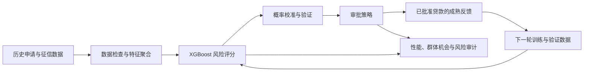

# 大数据算法歧视实验：贷款审批中的数据、目标与反馈

**Big Data Algorithmic Discrimination Experiment**

本项目用于辅助《云计算与大数据平台》课程汇报，以贷款审批为应用场景，在 Home Credit 历史贷款数据上研究：**训练数据的采集方式、系统的优化目标，以及审批后的数据反馈，如何影响不同群体获得贷款的机会。**

实验采用 XGBoost，在本机 CPU 上运行，参考 AWS 官方信用风险预测与偏差分析项目的流程。仓库提供可复现代码、实验协议、中文结果报告、英文汇报摘要和图表，可用于课堂展示、方法讨论与实验复现。

> 本项目是受控机制实验。它不代表银行生产系统，也不用于认定 Home Credit 存在实际歧视。群体指标差异是需要解释和审查的现象，不能直接等同于不公平歧视。

## 从哪里开始阅读

| 阅读目的 | 推荐入口 |
|---|---|
| 了解主要实验设计、结果与限制 | [主要结果报告](audit_extension/RESULTS_REPORT.md) |
| 查看评分固定时的审批目标权衡，以及早期反馈对照 | [基础三模块报告](COMPLETE_RESULTS_REPORT.md) |
| 准备英文课堂汇报 | [主要实验英文摘要](audit_extension/PRESENTATION_NOTES.md) · [基础实验英文摘要](PRESENTATION_NOTES.md) |
| 查看控制变量、训练损失公式和反馈信息规则 | [主要实验协议](audit_extension/PROTOCOL.md) |
| 查看方法审查及实验为何增加这些对照 | [方法审查记录](AUDIT_REPORT.md) |
| 运行实验 | [快速复现](#快速复现) |

## 1. 研究背景：高预测性能是否足够？

贷款审批通常先根据申请信息估计风险，再按照业务规则决定是否批准。但模型的总体预测能力不能完整说明不同群体受到怎样的对待。

例如，可观察征信记录较少的申请人，如果在训练数据中缺少正常还款案例，模型可能对这一群体形成偏高的风险判断。模型上线后，又通常只能看到已获批贷款的还款结果，后续训练和验证数据的构成会继续受到审批选择影响。

本实验围绕三个问题组织：

| 核心问题 | 实验关注点 | 课程讨论方向 |
|---|---|---|
| **数据怎么来？** | 群体代表不足、组内标签比例失真、参考分布纠正 | 数据采集、样本代表性与数据治理 |
| **系统优化什么？** | 预测损失、业务代价、机会导向目标、审批公平约束 | 模型训练与决策策略的目标权衡 |
| **系统如何更新？** | 选择性标签、探索采样、验证信息来源、多轮更新 | 模型生命周期、反馈采集与持续审计 |

## 2. 与云计算及大数据平台的关系

公平性问题贯穿数据与模型的整个处理流程，需要在数据准备、模型训练、策略执行和反馈管理中共同检查。



| 平台环节 | 本项目中的实现 | 可在课程汇报中讨论的扩展 |
|---|---|---|
| 数据处理 | 申请表与征信表关联、分块聚合、缺失值处理 | 云端数据存储、批处理与数据质量管理 |
| 模型训练 | CPU XGBoost、固定配置、多组对照 | 云端训练任务、实验管理与资源调度 |
| 决策与审计 | 风险预算、审批阈值、群体错拒指标 | 策略管理、模型监控与公平性审计 |
| 反馈管理 | 标签可见性台账、探索概率、更新批次 | 标签成熟管理、数据来源追踪与更新治理 |
| 可复现性 | 数据哈希、固定随机种子、策略冻结、独立核验 | 数据与模型版本管理 |

**实施范围：**本项目完成的是上述流程的本地 CPU 实验，没有实际部署 AWS 服务，也没有进行 Spark、分布式训练或云端扩展性能测试。云端架构对应关系用于课程分析，不作为已实现功能展示。

## 3. 数据、模型与评价方式

### 数据与分组

- **数据集：**Home Credit Default Risk。
- **规模：**307,511 条有标签贷款申请、1,716,428 条征信记录。
- **输入：**申请信息、征信聚合特征、收入与贷款负担比例等。
- **分组：**可观察征信记录为 **0—1 条**的申请记为征信记录较少组，报告中简称“薄弱组”；至少 **2 条**为比较组。零记录也可能来自数据覆盖不足，该分组不自动代表贫困或其他社会身份。
- **标签：**`TARGET=1` 表示前 Y 期中至少一期逾期超过 X 天，X/Y 未公开；`TARGET=0` 为其余情况，不表示永久不会违约。

数据通过固定版本的第三方 GitHub 镜像获取，原始发布入口为 [Kaggle Home Credit Default Risk](https://www.kaggle.com/competitions/home-credit-default-risk/data)。下载地址、文件大小与 SHA-256 记录在 [来源清单](data/raw/source.json) 中。代码进行了结构、标签数量与键的检查，但没有与官方数据逐值比对。

### 模型与审批

核心预测模型为 **XGBoost**；逻辑回归仅用于概率校准。模型输出风险分数后，再根据验证集选择审批阈值。

最新一轮实验统一使用 **200 棵树、最大深度 5、学习率 0.05、CPU 4 线程**。训练、参考、校准、验证、测试按贷款记录划分为 **50% / 10% / 10% / 10% / 20%**。主要业务规则是在验证集经验获批风险不超过 **5%** 时尽量增加批准人数。

基础静态实验使用了不同的树数设置，因此应在各轮实验内部比较对照，不能直接将不同轮次的数值相减归因于某项改进。

### 主要指标

| 指标 | 含义 |
|---|---|
| AUC | 模型区分两类历史还款标签的排序能力 |
| 群体错拒率 FRR | 某组 `TARGET=0` 记录中被策略拒绝的比例 |
| 错拒差距 | 两组 FRR 的绝对差，单位为百分点（pp） |
| 获批率 | 全部申请中获得批准的比例 |
| 获批风险 | 获批记录中 `TARGET=1` 的比例，非损失金额 |

“错拒”是相对于历史标签的操作性定义，不意味着每个被拒记录的决策都不合理。实验同时报告预测表现、两组机会、总体批准和风险，避免只凭单个公平指标判断策略优劣。

## 4. 三组实验如何设计

### A. 数据采样：把人数不足与标签比例失真分开

比较四种训练条件：

1. **同规模随机样本：**控制总训练人数。
2. **仅改变群体人数：**与偏置条件保持相同的两组人数，但保留各组原来的标签比例。
3. **选择性样本偏置：**仅减少薄弱组中的 `TARGET=0` 案例，真实标签本身不改动。
4. **参考分布纠正：**使用同一偏置样本，根据独立参考集的组别×标签比例调整训练权重。

设置 50% 和 25% 两档正常标签保留率、五个随机种子，检验差异来自群体构成还是组内标签组成。纠正方法依赖有代表性的有标签参考数据，不假定实际业务中总能获得这种信息。

### B. 优化目标：同时区分训练层与决策层

**训练层：**固定样本与树参数，比较标准交叉熵、业务代价加权、机会导向加权和组合目标。机会项给予两组正常标签的平均损失相同的组权重，通过 `sample_weight` 直接影响 XGBoost 训练。它是公平代理目标，不保证两组 FRR 相等。

**决策层：**基础实验固定风险分数，分别按准确率、业务风险预算、群体错拒差距约束选择审批规则；公平策略与无公平硬约束的业务策略采用相同的分组阈值搜索空间。

这两层对照分别回答“模型学习时重视哪些错误”和“评分之后如何分配批准机会”。

### C. 反馈更新：比较谁的标签可见，以及用什么数据验证

在五轮历史回放中，比较仅获批反馈与随机探索后逆概率加权更新，并交叉三种验证信息来源：

- **独立验证：**使用独立校准/验证池，人数匹配当前路径已获得的对应保留记录数。
- **仅可见反馈：**校准和验证只使用截至当前已揭示的标签。
- **固定初始验证：**不补充新的验证信息，继续使用初始保留记录。

每条记录事先指定训练、校准或验证角色，保留角色记录不进入树训练。六条路径共享同一初始状态；此外固定同一个模型、只替换验证信息选阈值，以区分模型变化与验证信息变化。

回放假定每批标签在下一次更新前已成熟；模拟轮次不是实际日期。探索需要额外批准部分原本被拒的申请，其风险另行计入。

## 5. 主要发现

以下结果来自最新一轮实验。除完整数据单一基线外，主要对照采用五个采样或模拟种子；表中差值由未取整数值计算。

| 观察 | 结果 | 应如何理解 |
|---|---|---|
| 人数构成变化 | 主场景薄弱组 FRR 差值 −0.13pp，条件95%区间 [−0.77, +0.52] | 本设定未检测到明确的方向性差异，不能推论人数不平衡永远无影响 |
| 同人数下标签比例失真 | 薄弱组 FRR 从 20.62% 升至 40.27%；配对增量 +19.64pp | 当前受控机制下，组内正常案例缺失带来明显额外错拒 |
| 参考分布纠正 | 偏置条件的薄弱组 FRR 从 40.27% 降至 21.24% | 与选择机制匹配的加权可恢复部分表现 |
| 机会导向训练目标 | 偏置数据上，错拒差距从 28.79pp 降至 1.30pp；比较组 FRR 从 11.48% 升至 16.28% | 改善伴随机会重新分配，并非所有群体都受益 |
| 强化机会权重 | 权重从1增至4后，偏置数据上的差距扩大至11.57pp | 更强的代理目标不一定对应更小的实际差距 |
| 验证信息与反馈 | 仅获批路径末轮，仅可见验证与独立验证的平均测试获批风险分别为5.04%和4.79% | 对应风险及薄弱组FRR差值区间均跨零，均值差异不足以建立稳定方向性结论 |

同样的机会权重1用于完整数据时，差距从 **6.28pp 变为7.40pp**，也没有改善该指标。这一反例与偏置数据上的正面结果一并保留。

当前反馈设定中，各信息模式下仅获批更新的薄弱组 FRR 从初始到末轮均下降，**未证明该指标随反馈持续放大**。实验的目的在于检验机制及其条件，不预设所有偏差必然恶化或所有纠正必然有效。


完整指标、所有轮次、配对区间及风险代价见 [主要结果报告](audit_extension/RESULTS_REPORT.md)。该轮完成 **220 个唯一模型、701 行策略评价**，其中包含450行同模型信息来源诊断；本机训练与评价耗时约21.3分钟，不含报告和核验，其他设备耗时会不同。

## 6. 如何用于课程汇报

建议按以下顺序组织实验部分：

1. **引入问题：**贷款审批的总体准确性与群体机会差异为何需要同时考察。
2. **展示数据实验：**用人数匹配的对照说明标签组成失真如何影响模型。
3. **展示目标权衡：**结合训练目标和审批目标，说明风险、性能与机会不能只用一个指标衡量。
4. **展示反馈路径：**解释审批决定如何改变后续可观察数据，以及验证信息来源的重要性。
5. **回到平台治理：**讨论数据来源追踪、训练与验证隔离、策略版本、风险监控和标签成熟管理。

| 汇报内容 | 可直接使用的图 |
|---|---|
| 采样机制 | [人数与标签组成对照](audit_extension/figures/01_sampling.png) |
| 训练目标 | [训练损失对照](audit_extension/figures/02_training_losses.png) |
| 审批目标 | [固定评分下的审批策略](figures/06_objectives.png) |
| 反馈更新 | [验证信息来源与五轮轨迹](audit_extension/figures/03_feedback.png) |
| 纠正的代价 | [包含探索的实际批准风险](audit_extension/figures/05_actual_risk.png) |

图中文字为英文，并提供同名 PDF，便于用于英文幻灯片和导出排版。

## 快速复现

环境：**Python 3.12、Windows PowerShell**。不需要 GPU 或 AWS 账号。

```powershell
git clone https://github.com/zjh-hao/Big-Data-Algorithmic-Discrimination-Experiment.git
cd Big-Data-Algorithmic-Discrimination-Experiment

$env:PYTHONUTF8 = "1"
python -m venv .venv
./.venv/Scripts/python.exe -m pip install -r requirements-lock.txt
./.venv/Scripts/python.exe -X utf8 src/prepare_data.py

# 生成基础实验、划分清单与预处理器
./run_complete.ps1

# 运行人数/标签组成、训练损失与验证来源的完整对照
./audit_extension/run.ps1
```

`prepare_data.py` 从固定来源下载输入并校验哈希，不执行第三方代码。数据获取及使用应遵守其原始条款。

首次克隆后需要先运行基础实验，再运行 `audit_extension`，后者依赖前者生成的划分和词表。程序保留断点；数据、参数或冻结代码变化时会拒绝混用旧结果。更多运行与输出说明见 [实验目录 README](audit_extension/README.md)。

## 仓库结构

```text
README.md                      项目介绍与课程汇报入口
src/                           基础实验、数据准备、报告与核验代码
tests/                         基础方法测试
config.json                    基础采样与训练配置
extensions_config.json         基础审批目标与反馈配置
results/                       已发布的汇总指标与核验记录
figures/                       基础实验图表，PNG/PDF
COMPLETE_RESULTS_REPORT.md     基础三模块报告
AUDIT_REPORT.md                 方法审查记录

audit_extension/
  PROTOCOL.md                  人数/标签组成、训练目标、验证来源协议
  run_experiment.py            完整对照实验实现
  config.json                  固定参数与随机种子
  test_methods.py              采样、损失等价性与信息来源测试
  verify.py                    标签可见性、权重、阈值与指标核验
  RESULTS_REPORT.md            主要结果报告
  PRESENTATION_NOTES.md        英文汇报摘要
  results/                     汇总结果与配对区间
  figures/                     六组 PNG/PDF 图表
```

仓库发布代码、协议、报告、图表和汇总结果；**原始数据、逐条申请预测与反馈台账、模型权重、虚拟环境和运行检查点保留在本地**，可通过复现生成。已发布的核验记录来自完成的实验；首次克隆后若要重新核验逐记录结果，需要先生成这些本地文件。

## 结论边界

- 样本偏置是人为设置的机制，不是对数据提供方历史行为的证明；完整数据基线也不等于无偏真值。
- 分组机会差距不自动代表不正当差别待遇；删除性别字段也不能保证其他特征不含代理信息。
- 历史已获贷样本不能提供真实被拒申请者的还款反事实，随机回放不能替代时间外验证。
- 独立参考数据、标签成熟和探索放贷均有条件与代价。验证集上的5%经验风险约束不能保证未来风险或探索后的整体风险。
- 后续实验使用了此前已查看过的测试集，不属于全新外部盲测。配对区间条件于当前数据与模拟，未覆盖时间漂移、自然人聚类或所有训练不确定性；辅助比较未作多重检验校正。
- 程序核验用于确认实现与协议一致，不能代替现实系统有效性或公平性的论证。

## 数据与流程参考

- [AWS 官方信用风险预测、解释与偏差分析项目](https://github.com/aws-samples/amazon-sagemaker-credit-risk-prediction-explainability-bias-detection)：作为流程参考，本项目没有直接复现其数据与全部服务配置。
- [Home Credit Default Risk 原始发布](https://www.kaggle.com/competitions/home-credit-default-risk/data)。
- [本实验使用的固定版本数据镜像](https://github.com/qwyt/HomeCreditDefaultRisk/tree/920bbfca12ac236a10ca6b9772286fa15f7a9cca/dataset/full)。
- [数据来源、校验值与获取边界](data/raw/source.json)。
