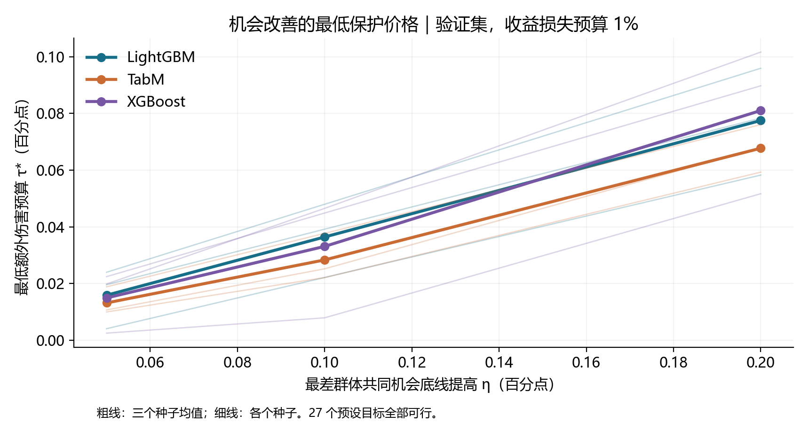

# 2026-10-22—23 研究更新：强基线、业务公平与双预算机会定价

本文汇总这一轮实际完成的基线复现、实验优化、自有方法和代码。所有数值来自已保存的实验结果，原始 V1/V2 内容继续保留。当前研究结论是：**以很小的情景贡献损失获得明显公平改善，并量化群体间的代价转移；现有证据不支持 SOTA 声明。**

## 1. 这次提交与原仓库的关系

- 新实验主要放在独立目录 [`research_extension_v3/`](research_extension_v3/README.md)，继续复用原项目的数据加载及固定划分。
- 原来的 `src/`、`tests/`、`audit_extension/`、`research_extension_v2/` 和历史结果未被替换；根 README 增加新研究入口。
- 预测器训练、审批策略优化、统计审计分开保存。后续方法复用冻结预测，不反复训练已完成模型。
- 提交代码、配置、官方来源版本、汇总 CSV、冻结策略、图表、数学推导和验证记录。
- 原始数据、逐申请人预测/决定、模型权重、训练缓存、工作进程锁、日志及重复 smoke/preflight 目录保留在本机，不纳入 Git。失败和退化的研究结论仍保留在正式报告及审计结果中。
- 发布前执行全仓库 `pytest -q`：**97 passed**。五个官方来源的关键文件均按固定哈希核验。

## 2. 实验协议与指标口径

使用 307,511 条有标签申请及申请前可观测的征信聚合；同一划分种子 `20261013`，train/reference/calibration/validation/test 比例为 **50/10/10/10/20%**，测试集 61,503 人。

| 环节 | 使用的数据 | 作用 |
|---|---|---|
| 特征与模型训练 | train | 插补、编码、归一化与模型拟合 |
| 超参数与早停 | reference | 有限搜索并冻结模型配置 |
| 概率校准 | calibration | Platt 校准 |
| 审批策略 | validation | 选择规则、拟合混合权重、计算改善价格 |
| 冻结评价 | test | 重放已保存策略，不重新选择参数 |

历史测试集此前已经查看，不能称本轮为新的盲测。相同测试人群上的多个模型种子也不是独立业务场景。

`TARGET=1` 表示历史还款困难，`TARGET=0` 表示正常标签；它不是逐笔真实银行损失。主业务情景使用：

$$U(w)=\sum_iq_i(w)[(1-y_i)-5y_i].$$

金额情景另计申请本金、利率、成本与损失参数。报告中的贡献是情景值，不能解释成已实现利润。主风险上限为困难标签获批数/全部获批数不超过 5%；主公平目标为两个信用记录组的正常客户误拒差距不超过 2 个百分点（pp）。

薄信用记录组为 `BUREAU_COUNT <= 1`，与训练集定义的收入三分位交叉形成六个审计子群。该分组不自动等同贫困群体或法律上的受保护身份。收入层只参与约束及审计，新增混合审批使用风险分数和信用记录组。

## 3. 已完成的复现与强基线

| 模型/方法 | 实际完成内容 | 测试 AUC 三种子均值 |
|---|---|---:|
| Logistic Regression | 有限 reference 搜索，共同特征及校准 | 0.755540 |
| XGBoost | 原树模型强对照，三种子 | 0.767128 |
| LightGBM | 首轮配置后扩展 12 个配置，reference 选择，三种子 | **0.774975** |
| TabM | ICLR 2025 作者源码；扩展 8 个配置；RTX 4060 GPU；三种子 | 0.764789 |
| M²FGB | FAccT 2025 `facct25` 作者核心实现，公平标签映射与适配 | 0.727668 |
| M²FGB tuned | 另做预设公平权重搜索，按 reference AUC 选择 | 0.767837 |
| Fairlearn | 官方 `ThresholdOptimizer`，原生目标和成本敏感业务目标 | 后处理策略，另报业务及公平指标 |

数据来源：[run001 模型比较](research_extension_v3/results/run_001/model_comparison.csv)、[run002 模型比较](research_extension_v3/results/run_002/model_comparison.csv)。部分配置为确定性，重复种子的相同输出不视为独立重复证据。

作者算法在本项目统一协议下的适配，不等于原论文所有数据集/所有设置复现。Fairlearn 是工具库；执行其中一种算法及参数，也不能代表覆盖了公平信贷领域所有强方法。

版本及来源记录在 [`upstream_sources.json`](research_extension_v3/upstream_sources.json)，引用见 [V3 REFERENCES](research_extension_v3/REFERENCES.md)。下载的官方源仓库中，TabM、M²FGB、Fairlearn 实际被代码调用；LightGBM 使用固定 pip 版本。Fair Credit Scoring 是业务评价参考，未冒充已完整复现其所有实验。

## 4. 补做了哪些机制实验和敏感性分析

| 内容 | 执行方式与发现 | 入口 |
|---|---|---|
| 样本量与标签组成 | 控制两组人数，区分“人少”和“正常标签被选择性遗漏”；五个采样种子 | `mechanisms.py` |
| 强模型偏见压力测试 | 扩大后的 LightGBM 上比较偏置、重加权、机会损失，15 个任务 | `followup.py` |
| 训练目标 | 完整与有偏数据上比较机会导向损失，保留负面结果 | `training_objective.py` |
| 概率校准消融 | 417 对可行的排序阈值审批决定均相同；另评价直接依赖概率的解析收益阈值 | `followup_analysis.py` |
| 阈值/资金敏感性 | 请求网格 256/513/1025；资金预算 100/80/60/40%；690 条策略中 70 条不可行 | `followup_analysis.py` |
| 风险和损失 | 风险 3/5/8%，损失比 3/5/7/10，固定主值与有限补充 | `business.py`、`followup_analysis.py` |
| 成本敏感 Fairlearn | 正常/困难标签业务代价对齐，验证上筛选，冻结后测试 | `fairlearn_business.py` |
| 不确定性 | 1,000 次配对申请人 bootstrap；随机审批执行与抽样区间分开 | `inference.py`、`protected_run.py` |

网格不完全嵌套，不宣称加密必定改进。采样偏置是受控机制实验，不代表 Home Credit 历史上实际发生了同样的删样本。

详细结果：[run002 后续实验报告](research_extension_v3/results/run_002/FOLLOWUP_RESULTS_CN.md)。

## 5. 自有审批方法：收益预算与最低必要伤害

普通公平约束只缩小两个总体均值之差，仍可能让某些正常客户群体承担更多误拒。run003 将六子群保护直接放进优化：在严格“每组相对同空间收益基准最多恶化 1pp”条件下，主要九个模型种子仅 **2/9 验证可行**。

run004 因此采用分阶段方法：

1. 在同一单调阈值混合空间内求收益最优基准。
2. 要求保留至少 99% 基准贡献，同时满足风险、资金及 2pp 宏观差距约束。
3. 求六子群最大误拒恶化的最小可行值 $d^\star$。
4. 公开允许 $d^\star+0.1\mathrm{pp}$ 的保护上限，优先改善绝对最差子群，最后最大化贡献。

0.1pp 是预设的额外群体损害预算，不是数值误差。原 1pp 保护目标和放宽后的有效上限分别记录；验证可行不意味着未来样本一定满足所有约束。

### LightGBM 三种子测试均值

| 方法 | 情景贡献↑ | 宏观误拒差距 pp↓ | 最差六子群误拒率 %↓ |
|---|---:|---:|---:|
| 同空间收益基准 | 35826.44 | 5.389 | 21.726 |
| 成本敏感 Fairlearn | 35460.80 | 1.990 | 20.915 |
| 普通硬阈值公平规则 | **35833.67** | **0.537** | **18.134** |
| run004 绝对最差组主方案 | 35770.98 | 1.219 | 18.337 |
| run006 归一化机会方案 | 35786.89 | 1.475 | 18.548 |

run004 相对收益基准仅损失约 **0.155%** 的情景贡献，宏观差距减少约 **4.170pp**。相对本次成本敏感 Fairlearn，贡献增加约 **310.18**、最差子群误拒降低约 **2.577pp**；实际风险使用量也不同，应共同解释。

普通硬阈值在表中三项指标上更好，但六子群最大基准伤害约 **1.920pp**，run004 约 **1.229pp**。这是明确的群体保护取舍，不能称所有指标同时领先。

完整方法、随机执行、收益预算与稳健变体：[run004 方法报告](research_extension_v3/results/run_004/METHODS_RESULTS_CN.md)。稳健版本更保守，却降低批准规模并可能提高绝对误拒；保留该负面结果。

## 6. 最新跨领域迁移：双预算与机会改善定价

借鉴云/网络资源分配的归一化、词典序公平和影子价格。既有 DRF、leximin、Nash、LP 和 DKW 均正常引用，项目贡献是具体信贷建模、预算分解、数学推导、工程实现及验证，不宣称首次发明这些工具。

令 $A_s(w)$ 为六个正常客户子群的机会，$w_0$ 为固定收益基准，业务可行集合 $\mathcal C_\beta$ 包含风险、资金、公平及贡献底线 $U\ge(1-\beta)U_0$。定义：

$$D(w)=\max\{0,\max_s[A_s(w_0)-A_s(w)]\},\qquad d^\star(\beta)=\min_{w\in\mathcal C_\beta}D(w).$$

双预算可行集合为：

$$\mathcal F_{\beta,\tau}=\{w\in\mathcal C_\beta:D(w)\le d^\star(\beta)+\tau\}.$$

- $\beta$ 控制银行最多允许多少贡献损失。
- $\tau$ 控制超过最低必要伤害后，最多允许多少额外群体损害。

### 6.1 归一化机会分配：有理论，但实测没有全面胜出

在同一个集合中计算每组机会范围 $[m_s,M_s]$，对可移动组使用 $z_s=(A_s-m_s)/(M_s-m_s)$，按升序坐标做完整 leximin，最后贡献择优。

- run005 严格零额外损害集合中，主设置最大子群跨度仅 **0.0001544pp**，没有实质可分配空间。
- 严格集合 27 个 leximin 中有 **3 个归一化数值认证失败**；原尺度业务约束通过。这些是保留的退化诊断，不能解释成数值精确成功。
- run006 将额外预算明确为 0.1/0.3pp，18 个完整 leximin 数值审计均通过。
- 完整 leximin 与一次归一化 maxmin 在本次 18 个配置中没有实质输出差异。
- 主预算下测试 2pp 差距达标，旧方案 **5/9**，归一化方案 **2/9**；归一化少伤害一些群体，却使绝对最弱组和宏观差距变差。

因此，**保留 run004 作为当前审批参考；归一化分配是对照，不替代主方案。**

### 6.2 更有业务意义的贡献：逆向机会价格

先求零额外损害集合中最好的绝对最弱机会：

$$W_0=\max_{w\in\mathcal F_{\beta,0}}\min_s A_s(w).$$

希望共同机会底线提高 $\eta$ 时，最低额外保护价格为：

$$\tau^\star(\eta)=\min_{\substack{w\in\mathcal C_\beta\\A_s(w)\ge W_0+\eta,\ \forall s}}D(w)-d^\star(\beta).$$

它回答“风险、资金和贡献底线不变时，改善最弱群体机会最低需要允许多少额外损害”。目标是提高共同最低门槛，不是每组相对自己原来的机会都增加同样幅度。最低价格后再最大化贡献，仍保留机会目标约束。

**LightGBM 三种子验证均值：**

| 希望提高的最低机会 | 最低额外伤害价格 | 相对收益基准贡献变化 |
|---:|---:|---:|
| 0.05pp | 0.01589pp | −0.1149% |
| 0.10pp | 0.03643pp | −0.1188% |
| 0.20pp | 0.07753pp | −0.1266% |



这些是额外保护价格，单位为百分点；总伤害还包括 $d^\star$，不能省略。全部 27 个预设目标在验证集可行。

**冻结后测试回放：**风险与贡献底线 **27/27** 满足，宏观差距 **8/27** 满足，最差群体机会 **23/27** 提高，完整达到预设提高幅度 **9/27**。LightGBM 的测试平均实际提高分别为 **0.0421/0.0922/0.1923pp**。测试增益比较两个冻结策略在测试集上的最弱机会，与验证集绝对目标分别记录。

已证明的问题性质包括：可行集紧凸与解存在、共同可达进展、完整 leximin 有限终止及机会向量唯一、指定业务集合内联合 Pareto 有效、最低伤害对收益预算的单调凸性、逆向价格对目标的单调凸性及分段线性。权重策略一般不唯一；这些是经验问题的理论性质，不是未来测试保证。

固定的 0.5/1/3% 收益预算下，各评分器的最低必要伤害没有改变，主设置收益约束局部对偶价格为0；在已检验范围内，多牺牲收益并非减少最低伤害的有效杠杆。

完整证明：[LaTeX 理论文档](research_extension_v3/theory_extension/theory_note/main.tex)，[实证附录](research_extension_v3/theory_extension/theory_note/empirical.tex)，[理论扩展代码](research_extension_v3/theory_extension/README.md)。文档已在桌面编辑器编译通过。

## 7. 不确定性与失败记录

- 配对申请人 bootstrap 不包含重新训练及重新选择阈值的不确定性。
- 随机混合的期望审批指标，与一次实际随机执行的结果分别报告。
- 六子群/两宏观群体 × 九个固定评分器的联合 DKW 审计采用明确 iid、独立固定评分器等假设；相对基准的界随对齐混合权重距离变化。
- 本数据宏观差距的联合统计界附加半宽约 **3.720pp**，因此没有宣称未来差距≤2pp的95%保证。
- 严格保护不可行、稳健方案成本、归一化退化、测试约束超出均保留。代码/指标检查通过与业务目标全部达标是不同结论。

## 8. 实际结果目录与代码地图

| 运行 | 内容 | 正式结果入口 |
|---|---|---|
| run001 | 18 模型种子、机制、训练目标、Fairlearn及业务情景 | [首轮报告](research_extension_v3/results/run_001/RESULTS_CN.md) |
| run002 | 12/8配置搜索、6最终模型、15偏置压力任务、敏感性 | [后续报告](research_extension_v3/results/run_002/FOLLOWUP_RESULTS_CN.md) |
| run003 | 24 冻结分数任务、279条策略；严格保护可行性 | [独立审计](research_extension_v3/results/run_003/protected_verification.json) |
| run004 | 24 任务、297条策略；最低伤害审批和稳定性 | [方法报告](research_extension_v3/results/run_004/METHODS_RESULTS_CN.md) |
| run005 | 9评分器、99条记录；严格集合与理论诊断 | [数值审计](research_extension_v3/results/run_005_theory/leximin_numerical_audit.json) |
| run006 | 9评分器、72条记录；双预算比较；27次逆向定价 | [完成记录](research_extension_v3/results/run_006_budget/completion.json) |

run004 的 37,629 项独立检查通过。run006 的 4,977 项回放/指标检查、18 个 leximin 数值审计通过；27 个定价策略测试重放另有 2,160 项独立检查通过。最新全仓库发布回归为 97 项测试通过，包含原代码及官方模型适配。

主要代码：

| 文件 | 职责 |
|---|---|
| `prepare.py`、`advanced_models.py`、`advanced_search.py` | 共同数据、官方算法适配、reference搜索 |
| `business.py`、`fairlearn_business.py` | 收益目标、业务约束、成本敏感对照 |
| `followup.py`、`followup_analysis.py` | 扩大搜索与有限消融 |
| `protected_policy.py`、`adaptive_run.py` | 六子群保护和最小必要伤害审批 |
| `protected_verify.py`、`protected_report.py` | 独立复核及报告 |
| `theory_extension/budget_allocation.py` | 显式双预算和完整leximin |
| `theory_extension/opportunity_price.py` | 验证集逆向定价 |
| `theory_extension/evaluate_prices.py` | 冻结27策略的测试重放 |
| `theory_extension/paired_certificate.py`、`audit_leximin.py` | 统计界与独立数值审计 |
| `setup_baselines.py`、`upstream_sources.json` | 固定上游版本及文件核验 |

## 9. 在新电脑上复现

### 9.1 环境与数据

Windows/PowerShell，Python 3.12。TabM 自动使用可用 CUDA，已记录实验使用 RTX 4060；CPU也可执行，但耗时不同。

```powershell
./run_research_v3.ps1 setup
.venv-v3/Scripts/python.exe -m src.prepare_data
.venv-v3/Scripts/python.exe -m research_extension_v3.setup_baselines --check-only
```

setup 获取三个实际运行所需的官方固定提交，不覆盖已有不同版本。默认源码位于仓库旁的 `credit-fairness-baselines/`；可在 setup 前设置 `$env:CREDIT_FAIRNESS_BASELINES` 指向其他目录。可选两个参考仓库通过 `setup_baselines --all` 获取。不要使用随时间变化的 `main` 替代记录中的提交。

### 9.2 发布结果与重新运行分开

**Git中的结果是历史证据，模型、逐行预测和缓存未上传，因此不能把新克隆直接当作可恢复的训练检查点。** 建议使用单独复现副本。首次从头运行前，将该副本中的 `research_extension_v3/results` 重命名为 `results_published`，保留历史证据，然后运行以下顺序。不要在保存唯一研究副本的工作区执行目录重命名。

```powershell
# 仅在新建的复现副本中、确认 results_published 尚不存在后执行
Rename-Item -LiteralPath ./research_extension_v3/results -NewName results_published

# 首轮训练 → 有限后续队列
./run_research_v3.ps1 run
.venv-v3/Scripts/python.exe -m research_extension_v3.background_queue

# 子群保护与最低必要伤害
.venv-v3/Scripts/python.exe -m research_extension_v3.protected_run
.venv-v3/Scripts/python.exe -m research_extension_v3.adaptive_run
.venv-v3/Scripts/python.exe -m research_extension_v3.protected_compare
.venv-v3/Scripts/python.exe -m research_extension_v3.protected_verify --run research_extension_v3/results/run_004
.venv-v3/Scripts/python.exe -m research_extension_v3.protected_report --run research_extension_v3/results/run_004 --require-complete

# 严格集合、双预算、逆向定价、测试回放
.venv-v3/Scripts/python.exe -m research_extension_v3.theory_extension.run
.venv-v3/Scripts/python.exe -m research_extension_v3.theory_extension.run_budget
.venv-v3/Scripts/python.exe -m research_extension_v3.theory_extension.opportunity_price --output research_extension_v3/results/run_006_budget/opportunity_prices
.venv-v3/Scripts/python.exe -m research_extension_v3.theory_extension.evaluate_prices
.venv-v3/Scripts/python.exe -m research_extension_v3.theory_extension.audit_leximin --run research_extension_v3/results/run_005_theory
.venv-v3/Scripts/python.exe -m research_extension_v3.theory_extension.audit_leximin --run research_extension_v3/results/run_006_budget
.venv-v3/Scripts/python.exe -m research_extension_v3.theory_extension.summarize

# 全仓库回归
.venv-v3/Scripts/python.exe -m pytest -q
```

GPU/平台可能造成微小数值差异。遇到输入、源码或冻结计划指纹不一致，应保留原结果并使用新的复现副本，不删除检查来强行续跑。队列有互斥锁和有限重试；本次发布没有待跑任务或仍启用的自动跟进。

### 9.3 发布时的兼容性修正

移除了模型适配中的 `D:/workspace` 与 setup 中个人目录的硬编码，改为相对仓库位置和可选环境变量。模型损失、参数、审批公式没有在发布步骤中重算或修改。

修改前的路径相关源码保存在 [`publication_source_archive/`](research_extension_v3/publication_source_archive/manifest.json)，历史结果的源码哈希保持原值；冻结来源与发布代码有少量路径发现差异，可以据此追踪。运行所需官方关键文件已逐一核验，发布前全仓库测试97项通过。

`.gitattributes` 对 V3 历史结果与源码归档关闭换行转换，避免 Git 将 CRLF/LF 自动规范化后使已登记的字节哈希失效；其他原有目录的换行规则保持原设置。

## 10. 当前汇报可以主张什么

可以主张：较小情景贡献损失下明显改善机会公平；识别严格保护的不可行性；量化附带群体伤害；给出双预算与逆向机会价格；完整保留强模型和标准算法对照及负面结果。

不主张：领域SOTA、所有指标全面最优、真实银行利润已提升、历史数据实验已证明现实因果歧视、经验约束已变成未来人群保证。

建议汇报主线：**偏见机制 → 强基线 → 公平业务成本 → 最低必要伤害 → 双预算与机会定价 → 测试兑现误差及适用范围。**
