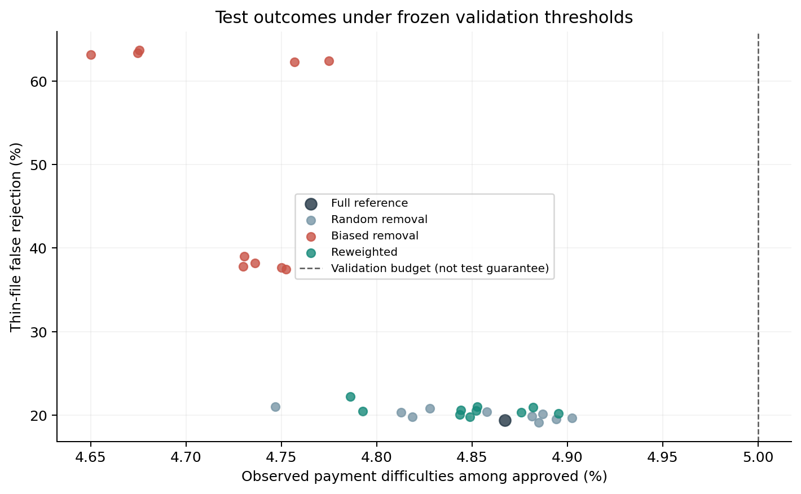
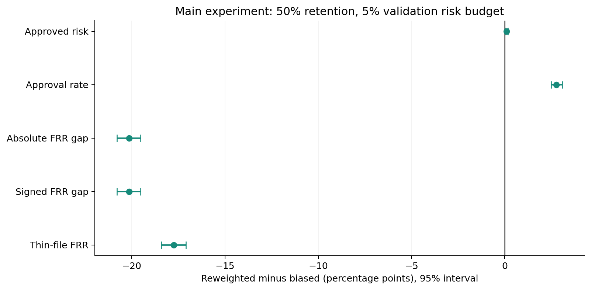
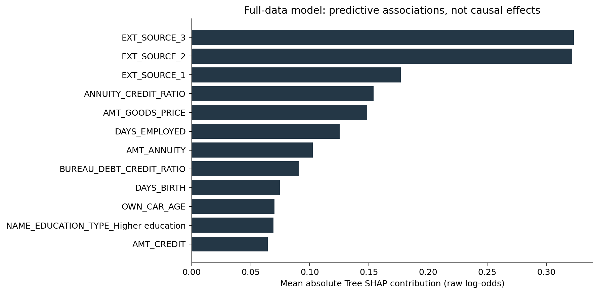
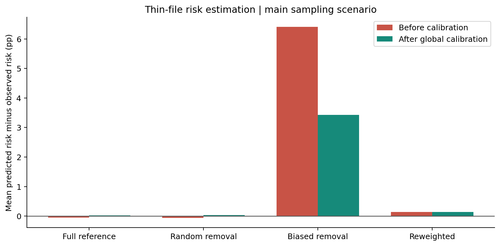

# 实验结果报告：信用记录薄弱客户的样本偏差与纠正

## 1. 结论

本机 CPU 已完成 31 个正式对照模型，另有 4 个超参数候选模型。主实验保留薄弱记录组 TARGET=0 样本的 50%，以验证集获批者还款困难率不超过 5% 选择统一审批阈值。

- 纠正相对偏置模型：薄弱组错拒率变化 **-17.74 个百分点**，近似 95% 配对区间 **[-18.41, -17.09]**。
- 薄弱组错拒率的下降区间未跨过 0，支持该受控机制下存在改善。绝对错拒差距也有稳定下降。
- 获批者还款困难率变化 **+0.10 个百分点**，区间 **[+0.01, +0.17]**；应结合下面的风险与机会结果解释。
- 比较组错拒率变化 **+2.39 个百分点**。修复减少了薄弱组的额外错拒，同时也改变了比较组的批准机会，并非所有客户都受益。
- 在 5% 验证预算下，31 个模型中 **0 个**在测试集的观察风险超过 5%。验证约束不构成未来风险保证。

这是受控样本选择机制的实验结论，不是对 Home Credit 历史歧视行为的认定。

## 2. 官方参考、真实数据与本地实现

流程参考 AWS 官方信用风险预测、解释和偏差缓解项目。AWS 使用 South German Credit、XGBoost 和 SageMaker；本实验使用 Home Credit 数据与本机 XGBoost，采用独立参考集估计联合分布权重。没有运行 AWS 云服务，也没有复现其多目标调参算法；不能称为 AWS 或银行的生产模型。

数据通过第三方 GitHub 镜像获取，申请表 307,511 行、原始 122 列；征信表 1,716,428 行、17 列。原始阳性标签 24,825 个，薄弱组 80,093 人。镜像代码显示 CSV 直接转换成 Parquet；结构及标签核验通过，但没有官方字节哈希可验证逐值完全一致。文件网址、固定提交和 SHA-256 见 `data/raw/source.json`。

原始数据审计：薄弱组的观察还款困难率为 9.43%，比较组为 7.59%。因此不能把所有原始审批差距都解释为歧视；完整数据基线也保留了组间差异。

TARGET=1 指在前 Y 期还款中至少一期逾期超过 X 天；X、Y 未公开。TARGET=0 是其余情况，下文“正常/错拒”均相对此标签，不代表永久不会违约，也不是实际经济损失。

## 3. 实验设计与防止信息泄漏

- 研究组：申请前可观察征信记录 0—1 条；比较组：至少 2 条。零记录可能源于数据覆盖，不能等同于现实中无信用历史。该分组并非法律上的受保护属性。
- 按贷款记录分成训练 50%、参考 10%、概率校准 10%、验证 10%、测试 20%，按组别×标签分层，ID 无交叉。
- 输入包含申请信息及征信聚合，排除 ID、TARGET 和性别。保留缺失信息；处理工作天数哨兵值，增加收入负担比。征信未来开立/更新记录排除 17 条；没有使用未来合同到期日推断实际未来还款。数据没有绝对申请时间，无法做跨年份验证。
- 特征编码仅在完整训练集拟合，所有条件共享词表与特征空间。XGBoost 原生处理数值缺失。超参数只用完整训练集和验证集选择，锁定为 `{'max_depth': 5, 'n_estimators': 400}`。
- 选择性删减只针对薄弱组 TARGET=0，保留率 50% / 25%，每档 5 个固定种子。真实标签不改；同规模随机对照具有相同训练人数。
- 纠正模型与偏置模型使用完全相同记录。权重为参考集 P(组别,标签) / 偏置训练集 P(组别,标签)，不强行让组别与风险标签独立，不使用测试标签或已知保留率估计权重。
- 所有模型在独立校准集上做全局 Platt 校准，再在验证集选批准人数最多且观察风险不超过预算的统一阈值，至少需 500 个验证获批者；没有可行阈值就拒绝全部，不偷偷放宽预算。相同分数整体接受或拒绝。
- 所有模型与阈值先保存到 `frozen_decisions.json`，之后才计算测试预测与指标。3%、8% 是预先规定的补充预算。

## 4. 主实验测试结果

随机、偏置、纠正行是 5 个采样种子的均值；完整训练参考只有一个模型。FRR 为 TARGET=0 中被拒绝比例。正的有符号差距意味着薄弱组错拒更多，绝对差距另行衡量。

| 条件 | AUC | 获批率 | 获批风险 | 薄弱组错拒 | 比较组错拒 | 有符号差距 | Brier |
|---|---|---|---|---|---|---|---|
| 完整训练参考 | 0.7717 | 82.11% | 4.87% | 19.42% | 13.51% | 5.91 pp | 0.06707 |
| 同规模随机删减 | 0.7709 | 81.85% | 4.85% | 19.82% | 13.71% | 6.11 pp | 0.06713 |
| 选择性样本偏差 | 0.7627 | 79.09% | 4.74% | 38.03% | 11.14% | 26.89 pp | 0.06777 |
| 联合分布加权纠正 | 0.7715 | 81.85% | 4.84% | 20.29% | 13.54% | 6.75 pp | 0.06709 |

### 纠正减去偏置：主实验差值

| 指标 | 变化与 95% 区间（百分点） |
|---|---|
| thin_frr | -17.74 [-18.41, -17.09] |
| signed_frr_gap | -20.14 [-20.78, -19.51] |
| abs_frr_gap | -20.14 [-20.78, -19.51] |
| approval_rate | +2.76 [+2.48, +3.08] |
| approved_risk | +0.10 [+0.01, +0.17] |

区间使用 1000 次配对重采样：同一测试贷款记录在所有模型中同步重采样，并重采样 5 个训练采样种子。没有重新分割数据或重新训练每个 bootstrap 模型，故区间条件于当前划分、参考集和校准集；仅 5 个种子，训练不确定性估计有限。多个辅助指标没有多重检验校正。

完整的 25% 压力实验、3% / 8% 预算以及“偏置−同规模随机对照”的差值均保留在 `results/metrics.csv`、`summary.csv`、`paired_intervals.csv`。不得只挑最显著的场景展示。

### 所有预设场景的纠正前后均值

| 样本保留率 | 验证风险预算 | 偏置薄弱组错拒 | 纠正薄弱组错拒 | 偏置获批风险 | 纠正获批风险 |
|---|---|---|---|---|---|
| 50% | 5% | 38.03% | 20.29% | 4.74% | 4.84% |
| 50% | 3% | 76.18% | 56.36% | 2.70% | 2.70% |
| 50% | 8% | 0.32% | 0.06% | 7.98% | 8.02% |
| 25% | 5% | 62.97% | 20.94% | 4.71% | 4.86% |
| 25% | 3% | 92.24% | 56.44% | 2.71% | 2.73% |
| 25% | 8% | 0.43% | 0.10% | 7.99% | 8.01% |

8% 预算接近样本总体风险，模型几乎批准全部客户，所以纠正的错拒改善幅度明显缩小；部分模型的测试风险略超过 8%。这说明公平性效果依赖审批政策，也再次说明验证预算不能保证测试风险达标。

## 5. 图表与解释

Tree SHAP 来自完整训练参考模型，使用预设随机的 1,500 个测试特征行；没有用于选模。贡献单位为未校准 log-odds，显示预测关联，不能证明某字段导致歧视。全局校准是所有条件共同的操作；正单调校准不改变排序，在验证排序阈值策略下不会自行改变可选批准集合，因此不能把其与样本纠正混为同一个干预。

## 6. 局限与业务含义

1. 原始数据并非全体申请者的随机样本，也不含被拒客户的可观察还款反事实；完整训练模型只是当前数据内的参考，并非无偏真值。
2. 受控删减展示的是一个设定机制。它没有证明金融机构实际按此方式采样，也不等价于拒绝推断已被解决。
3. 权重纠正依赖代表性且有标签的参考样本；真实业务中可能需要独立审计或长期跟踪，不能凭空获得。
4. 更低组间差距并不自动意味着更正确的决策，必须同时看薄弱组错拒、总体获批、风险和概率校准。群体真实风险差异可以保留。
5. 风险预算由验证集经验值确定，可能发生过拟合或漂移；5% 为课堂设定，非 Home Credit 标准。没有损失率、利率和资金成本，不能报告真实利润收益。
6. 本地 CPU 展示的是云端 ML 流程的本地实现，不涉及云部署、分布式性能或在线监控的实测。汇报可把这些列作部署扩展。

## 7. 复现与来源

- Python / 包版本见 `requirements-lock.txt` 与 `results/completion.json`；设备 CPU，线程 4。
- 31 个正式模型训练、校准及验证累计 376.4 秒；本次完整主程序耗时 449.6 秒（不含下载、依赖安装和报告 bootstrap）。
- 执行 `./run.ps1` 完成数据检查、方法测试、训练、图表报告与独立指标核验；重复执行可复用同一配置和代码的模型检查点。
- 独立核验结果见 `results/verification.json`。README 说明数据下载与目录结构。
- [AWS 官方参考](https://github.com/aws-samples/amazon-sagemaker-credit-risk-prediction-explainability-bias-detection)
- [Home Credit 原始发布](https://www.kaggle.com/competitions/home-credit-default-risk/data)
- [GitHub 数据镜像](https://github.com/qwyt/HomeCreditDefaultRisk/tree/920bbfca12ac236a10ca6b9772286fa15f7a9cca/dataset/full)
- [镜像格式转换源码](https://github.com/qwyt/HomeCreditDefaultRisk/blob/920bbfca12ac236a10ca6b9772286fa15f7a9cca/src_draft/load_dataset.py)
