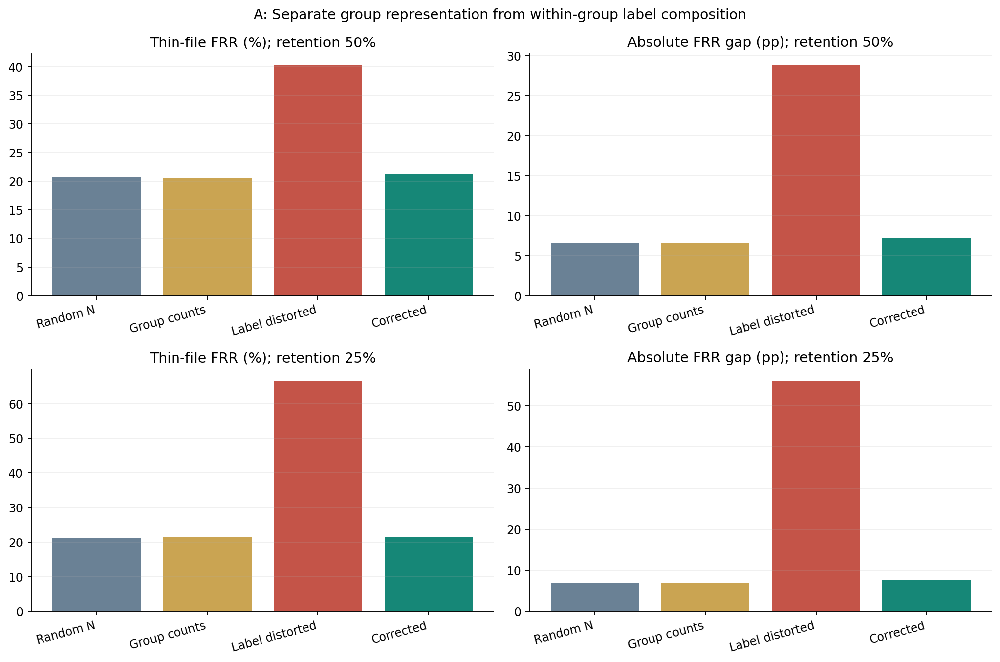
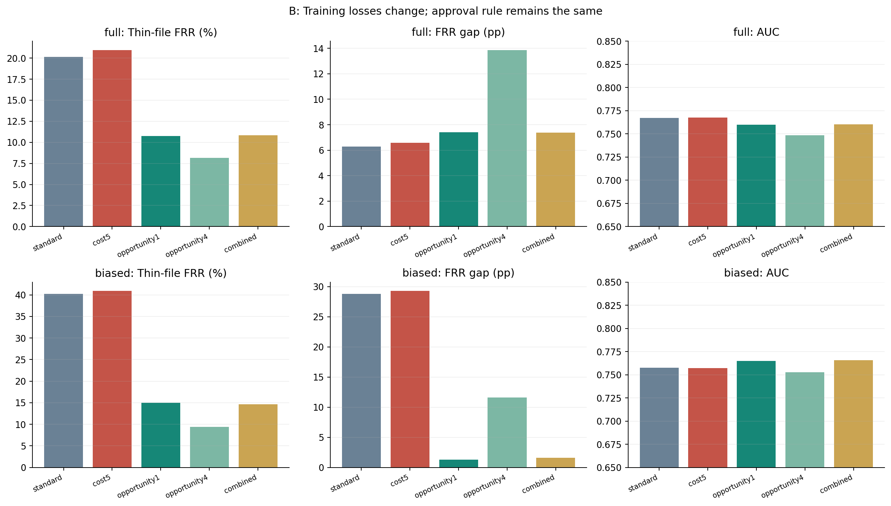
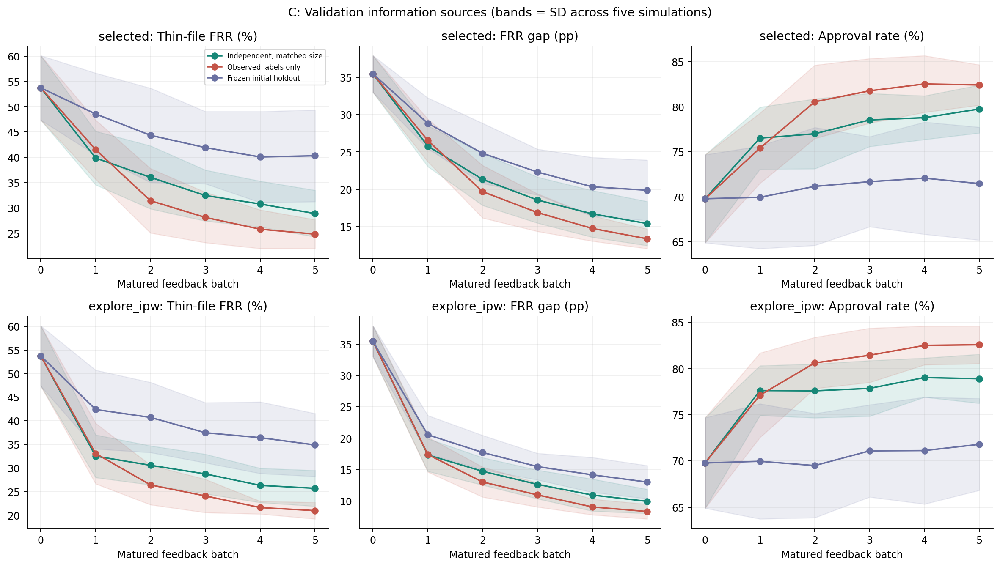
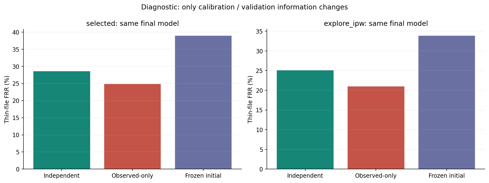
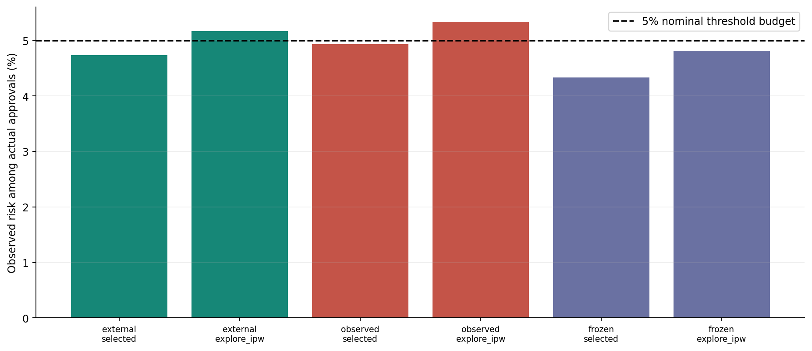
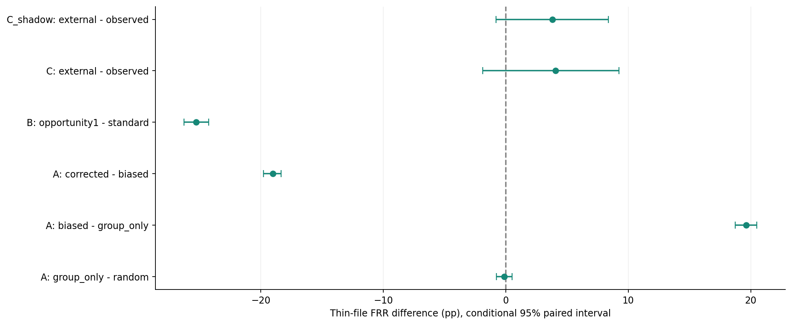

# 审查补充实验结果：样本构成、验证反馈与训练目标

## 1. 本轮解决了什么

| 审查问题 | 新增设计 | 能回答的范围 |
|---|---|---|
| 1. 人数不足与标签失真混在一起 | 同总量随机、同组别人数且保留组内比例、标签失真、纠正四组 | 在当前受控机制下区分群体构成与组内标签组成 |
| 2. 反馈始终有独立验证支持 | 独立匹配大小、仅可见标签、固定初始三种信息模式；额外同模型诊断 | 比较外部验证支持如何影响反馈轨迹和固定模型的阈值决策 |
| 4. 未改变训练损失 | 标准、业务代价、机会导向及组合加权交叉熵 | 直接比较训练阶段的目标改变；原决策层实验继续作为另一层对照 |

共完成 **220 个唯一模型**：A 41个；B新增24个、连同复用基线共30行；C 155个。共701行冻结策略测试评价（含450行同模型信息诊断）。CPU 4线程，训练和评价总耗时 21.3 分钟，不含报告、核验。原实验完整保留。

所有新增模型统一200棵树、depth=5；不能将这里的新数值与旧400棵静态实验简单相减归因于本次干预。所有新增训练/阈值先冻结，随后统一评价测试集。该测试集在旧实验已查看，故本轮仍是后续机制研究，不是全新外部盲测。

### 主要观察

1. 主采样场景：group_only薄弱组错拒 20.62%，biased为 40.27%。在群体人数相同的情况下，标签组成失真对应更大的错拒变化；人数构成变化本身的区间见第3节。
2. 在biased数据上，机会权重1把差距从 28.79pp降至 1.30pp，但比较组错拒从 11.48%升至 16.28%。机会目标改变了分配，不是所有人同时受益。
3. 同一机会权重在full数据上使绝对差距从 6.28pp变为 7.40pp。代理目标并不保证缩小实际FRR差距，完整数据上的不利结果不能省略。
4. 仅获批路径末轮，observed的薄弱组错拒 24.80%低于external的 28.87%，但平均测试获批风险分别为 5.04%和 4.79%。验证偏差的后果可能表现为风险约束失准，不能把更低错拒率单独当作更优结论。

## 2. 数据、指标与共同边界

沿用 Home Credit 第三方GitHub镜像和原贷款记录级划分；目标是公开 TARGET 还款困难标签，不等同于终身违约或实际损失金额。薄弱组是0—1条可观察征信记录，比较组至少2条。FRR=标签0中被拒比例，是历史标签下的操作性机会指标；群体差距本身不能证明歧视。

所有审批规则都是在对应验证信息上选择最大批准人数，经验获批风险不超过5%；这不是未来风险保证。新增完整实验不包含真实云服务、真实拒贷反事实、日历时间外验证或真实利润核算。

## 3. A：区分群体构成与组内标签组成

random、group_only、biased 和 corrected 的总人数相同；后三者两组人数也相同。group_only 保持各组原来的标签比例（整数误差不超过1条）；biased 仅删掉薄弱组标签0记录。

以50%保留率、种子17为例，四个标签单元格的训练人数如下。0/1指TARGET，corrected的记录与biased相同，只改变权重：

| 条件 | 比较组0 | 比较组1 | 薄弱组0 | 薄弱组1 | 总量 |
|---|---|---|---|---|---|
| random | 92765 | 7607 | 31941 | 3307 | 135620 |
| group_only | 105074 | 8635 | 19844 | 2067 | 135620 |
| biased | 105074 | 8635 | 18134 | 3777 | 135620 |
| corrected | 105074 | 8635 | 18134 | 3777 | 135620 |

| retention | condition | AUC | 薄弱组错拒% | 比较组错拒% | 差距pp | 获批率% | 获批风险% |
|---|---|---|---|---|---|---|---|
| 0.25 | biased | 0.7356 | 66.62 | 10.52 | 56.10 | 72.43 | 4.70 |
| 0.25 | corrected | 0.7671 | 21.42 | 13.85 | 7.57 | 81.33 | 4.82 |
| 0.25 | group_only | 0.7661 | 21.59 | 14.55 | 7.04 | 80.75 | 4.78 |
| 0.25 | random | 0.7665 | 21.17 | 14.29 | 6.88 | 81.07 | 4.82 |
| 0.5 | biased | 0.7576 | 40.27 | 11.48 | 28.79 | 78.28 | 4.72 |
| 0.5 | corrected | 0.7674 | 21.24 | 14.10 | 7.14 | 81.16 | 4.78 |
| 0.5 | group_only | 0.7674 | 20.62 | 14.02 | 6.61 | 81.41 | 4.83 |
| 0.5 | random | 0.7668 | 20.76 | 14.18 | 6.57 | 81.26 | 4.82 |
| 1.0 | full | 0.7672 | 20.13 | 13.85 | 6.28 | 81.66 | 4.84 |

主50%场景的薄弱组错拒差值：

- 群体构成效应 group_only−random：**-0.13pp，条件95%区间[-0.77, +0.52]**。
- 同人数下标签组成效应 biased−group_only：**+19.64pp，条件95%区间[+18.75, +20.49]**。
- 参考分布纠正 corrected−biased：**-19.03pp，条件95%区间[-19.77, -18.34]**。

现在可以分别观察这两种采样变化的影响，而不能预设人数少就一定造成显著差异。第一项控制总人数、改变群体构成；第二项再固定两组人数，改变组内标签组成。它们不是无条件可加的普遍因果分解。纠正仍依赖代表性有标签参考集、且与人为选择机制匹配，未证明对未知缺失机制普遍有效。

## 4. B：改变训练损失，保持审批规则相同

所有配置使用相同训练记录和模型参数。标准目标是平均二元交叉熵；cost5将标签1的训练损失代价乘5；opportunity1/4分别增加权重1/4的“两组正常标签平均交叉熵”；combined同时采用cost5与机会权重1。公式和等价权重见 PROTOCOL.md，权重进入模型训练梯度，不是训练完再改阈值。

机会项给予两组正常标签相同的组总权重，是机会导向的可加代理目标，**不是直接约束两组FRR相等**。没有保证公平改善、AUC提升或双方同时受益。标准与全部加权模型使用同一独立校准、验证集合及统一风险约束审批规则；原始加权分数需要校准，不能直接当作真实PD。

| dataset | loss | AUC | 薄弱组错拒% | 比较组错拒% | 差距pp | 获批率% | 获批风险% |
|---|---|---|---|---|---|---|---|
| biased | combined | 0.7657 | 14.67 | 16.28 | 1.60 | 81.27 | 4.84 |
| biased | cost5 | 0.7572 | 40.93 | 11.64 | 29.30 | 77.98 | 4.69 |
| biased | opportunity1 | 0.7649 | 14.97 | 16.28 | 1.30 | 81.19 | 4.83 |
| biased | opportunity4 | 0.7527 | 9.37 | 20.94 | 11.57 | 79.23 | 4.83 |
| biased | standard | 0.7576 | 40.27 | 11.48 | 28.79 | 78.28 | 4.72 |
| full | combined | 0.7605 | 10.86 | 18.24 | 7.39 | 80.83 | 4.86 |
| full | cost5 | 0.7677 | 20.95 | 14.39 | 6.57 | 81.00 | 4.75 |
| full | opportunity1 | 0.7601 | 10.75 | 18.14 | 7.40 | 80.90 | 4.83 |
| full | opportunity4 | 0.7484 | 8.14 | 22.01 | 13.87 | 78.77 | 4.82 |
| full | standard | 0.7672 | 20.13 | 13.85 | 6.28 | 81.66 | 4.84 |

五个 biased 数据条件下，相对standard的薄弱组错拒差值：

- cost5：+0.67pp，条件95%区间[-0.06, +1.37]
- opportunity1：-25.29pp，条件95%区间[-26.28, -24.26]
- opportunity4：-30.89pp，条件95%区间[-31.93, -29.84]
- combined：-25.59pp，条件95%区间[-26.49, -24.74]

`metrics_B.csv` 同时保留原始Brier、校准Brier、AUC与标签1拒绝率，避免只展示机会指标。完整数据full只有一份基线，不能称作五次独立重复；biased的五个种子反映同一数据内的受控采样变化。代价5和机会权重不是金融机构真实业务参数，所有固定档位均展示，不在测试集上挑最佳档。

**强权重不一定更公平：**biased数据上，机会权重从1增至4后，绝对FRR差距由 1.30pp变为 11.57pp；两组错拒关系已经反向。AUC同时由 0.7649变为 0.7527。这说明“优先降低某类错误”的训练代理目标与“差距小”的评价目标并不等价，应把原有决策层硬约束实验一起讲清楚。

## 5. C：验证信息来源是否改变反馈结论

### 5.1 隔离方式

初始20%训练池有同样的偏置。每条记录在看标签前随机指定80/10/10%的训练/校准/验证角色；后两者永远不入树训练。只有正常批准或随机探索批准后才能获得该条记录标签。所有六条路径共享初始模型、初始校准和验证集，从第一次更新起改变信息来源：

- **external**：独立校准/验证池，人数分别匹配本路径截至当轮可见的保留角色记录数。
- **observed**：仅截至当前可见的保留角色标签，没有独立代表性验证信息。
- **frozen**：固定初始有偏校准/验证记录，作为不补充验证信息的参照。

每种信息模式配 selected 与 explore_ipw 两种数据获取策略。IPW只加权探索路径的树训练记录；保留验证池直接反映可见反馈组成。初始数据不追溯纠正。分支逐轮分化后观察人数也可能不同，因此轨迹比较是完整系统策略的差异。

每批结果假定在下一批前成熟，仍不是现实日历模拟。observed模式也会重复使用历史可见验证标签，可能有适应性过拟合，不能把它当作无偏验证的推荐做法。

### 5.2 第五轮测试结果（五种子均值）

| mode | acquisition | AUC | 薄弱组错拒% | 比较组错拒% | 差距pp | 获批率% | 获批风险% |
|---|---|---|---|---|---|---|---|
| external | explore_ipw | 0.7584 | 25.69 | 15.75 | 9.94 | 78.89 | 4.79 |
| external | selected | 0.7628 | 28.87 | 13.44 | 15.43 | 79.76 | 4.79 |
| frozen | explore_ipw | 0.7570 | 34.87 | 21.87 | 13.01 | 71.80 | 4.21 |
| frozen | selected | 0.7609 | 40.29 | 20.42 | 19.88 | 71.47 | 4.16 |
| observed | explore_ipw | 0.7598 | 20.95 | 12.64 | 8.31 | 82.56 | 5.10 |
| observed | selected | 0.7636 | 24.80 | 11.42 | 13.38 | 82.43 | 5.04 |

- external：仅获批更新的薄弱组错拒从 53.72% 到 28.87%，降低 24.86pp；区间见下表。起终点变化不等于逐轮单调变化。
- observed：仅获批更新的薄弱组错拒从 53.72% 到 24.80%，降低 28.92pp；区间见下表。起终点变化不等于逐轮单调变化。
- frozen：仅获批更新的薄弱组错拒从 53.72% 到 40.29%，降低 13.43pp；区间见下表。起终点变化不等于逐轮单调变化。

- external，末轮−初始：-24.86pp，条件95%区间[-31.85, -18.55]
- observed，末轮−初始：-28.92pp，条件95%区间[-34.20, -23.68]
- frozen，末轮−初始：-13.43pp，条件95%区间[-15.86, -11.35]

在相同获取策略下，external−observed的薄弱组错拒差值：

- selected：**+4.07pp，条件95%区间[-1.89, +9.25]**。
- explore_ipw：**+4.73pp，条件95%区间[+0.78, +8.75]**。

**不确定性解释：**本次 selected 路径 external−observed 的末轮薄弱组FRR差值区间跨零，获批风险差值区间也跨零；固定同模型的对应比较亦如此。因此这些均值差异尚不足以支持稳定的方向性结论。当前五个模拟种子仍不足以确定外部验证对这两项指标的平均效应方向，不能把观察均值写成普遍规律。

必须同时检查批准风险和批准人数：如果某路径通过接近全部批准降低FRR，不能据此称其更公平或更优。是否支持“偏差放大”，只按当前信息模式、具体指标和时间范围判断；不为了得到恶化轨迹修改参数。

### 5.3 固定同一个模型，只改变验证信息

以下固定 observed 路径的末轮模型，只替换校准/验证信息来源；不把这些诊断决策回灌到模型。AUC因评分排序相同而相同，审批阈值可以不同。external与observed参照记录数匹配，frozen样本更少。

| acquisition | information | AUC | 薄弱组错拒% | 比较组错拒% | 差距pp | 获批率% | 获批风险% |
|---|---|---|---|---|---|---|---|
| explore_ipw | external | 0.7598 | 25.05 | 15.34 | 9.71 | 79.33 | 4.78 |
| explore_ipw | frozen | 0.7598 | 33.81 | 21.06 | 12.74 | 72.66 | 4.24 |
| explore_ipw | observed | 0.7598 | 20.95 | 12.64 | 8.31 | 82.56 | 5.10 |
| selected | external | 0.7636 | 28.59 | 13.80 | 14.79 | 79.55 | 4.76 |
| selected | frozen | 0.7636 | 38.89 | 20.83 | 18.05 | 71.46 | 4.09 |
| selected | observed | 0.7636 | 24.80 | 11.42 | 13.38 | 82.43 | 5.04 |

- selected，同模型 external−observed 薄弱组FRR：**+3.79pp，条件95%区间[-0.79, +8.38]**。
- explore_ipw，同模型 external−observed 薄弱组FRR：**+4.09pp，条件95%区间[+0.86, +7.66]**。

这组对照排除了模型评分差异，显示的是验证信息改变决策的效应。正单调校准不改变分数排序；在当前按完整排序前缀选阈值的规则下，关键在验证标签和样本组成，而非校准自动消除了偏见。

### 5.4 实际放贷风险与探索成本

| 信息模式 | 更新策略 | 实际批准风险% | 探索批准总数/种子 |
|---|---|---|---|
| external | selected | 4.73 | 0.0 |
| external | explore_ipw | 5.17 | 2891.0 |
| observed | selected | 4.93 | 0.0 |
| observed | explore_ipw | 5.34 | 2648.6 |
| frozen | selected | 4.34 | 0.0 |
| frozen | explore_ipw | 4.82 | 3637.6 |

风险按五轮、五种子所有实际批准记录汇总，包含探索批准；探索数为每种子五轮平均总数。重复模拟不等于真实新增人口。这里与独立测试的常规策略风险口径不同；5%阈值规则没有约束探索后的整体风险，也不保证biased observed验证能够控制总体风险。

## 6. 统计、核验与可复现性

所有差值使用同一测试记录配对bootstrap1000次，并配对重采样五个模拟/采样种子；full损失比较只有一个固定模型对。区间条件于当前数据划分、参考和验证机制，不包含重新划分重训、真实人群漂移、自然人聚类或拒贷反事实。多项辅助比较未校正多重检验。全部差值见 `results/paired_intervals.csv`。

方法单测检查人数对照、声明损失与权重等价、验证来源。独立核验从台账重建可见数据，检查训练/校准/验证角色隔离、探索概率、IPW、各模式参考来源、阈值可行性与最大批准前缀、测试指标。当前核验检查数：9768，详见 `results/verification.json`。通过核验不等于现实金融系统有效性证明。

## 7. 汇报建议

建议将旧三问结构保留：A新增“同人数、同群体人数”对照；B同时讲训练损失与旧决策目标；C把独立验证支持作为可改变的实验条件，展示所有轨迹及实际批准风险。不要只展示最小错拒率，更不要把机会代理损失叫作已实现严格机会平等。

复现命令、结果目录见 README；实验公式与冻结参数见 PROTOCOL.md。原数据来源和AWS流程对应关系沿用上级README。本地CPU实验并未运行云端审批系统。
