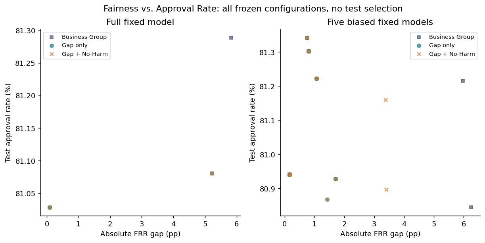
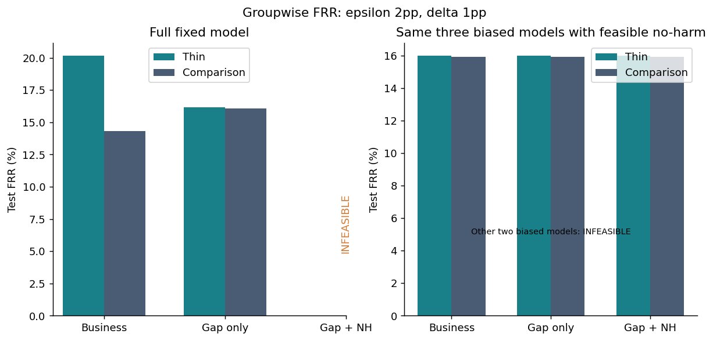
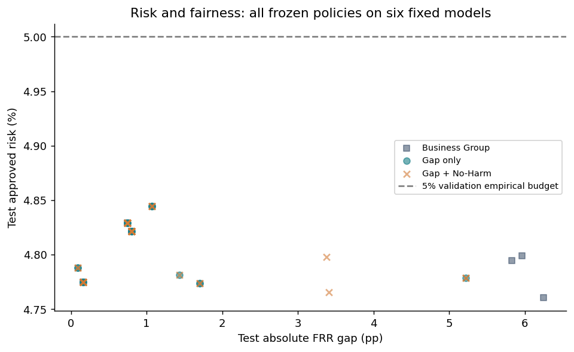
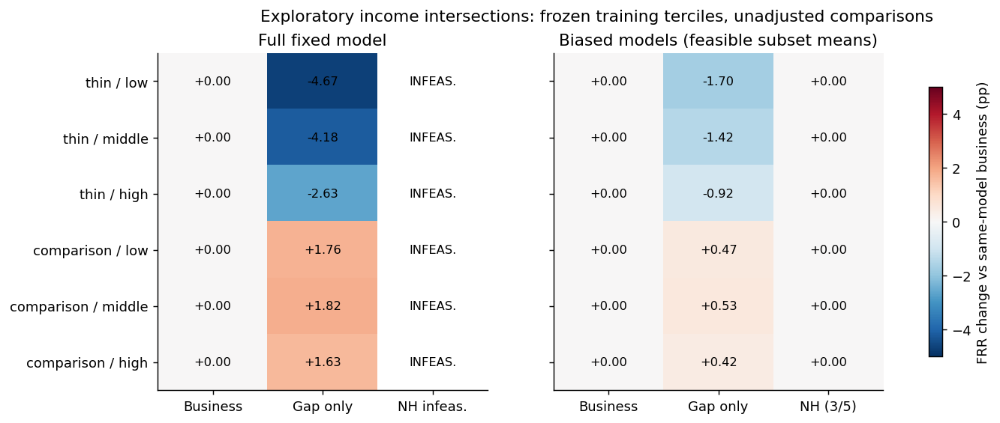
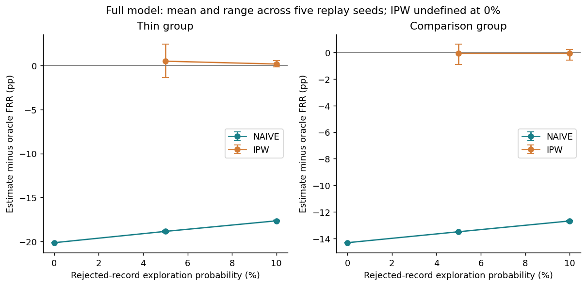
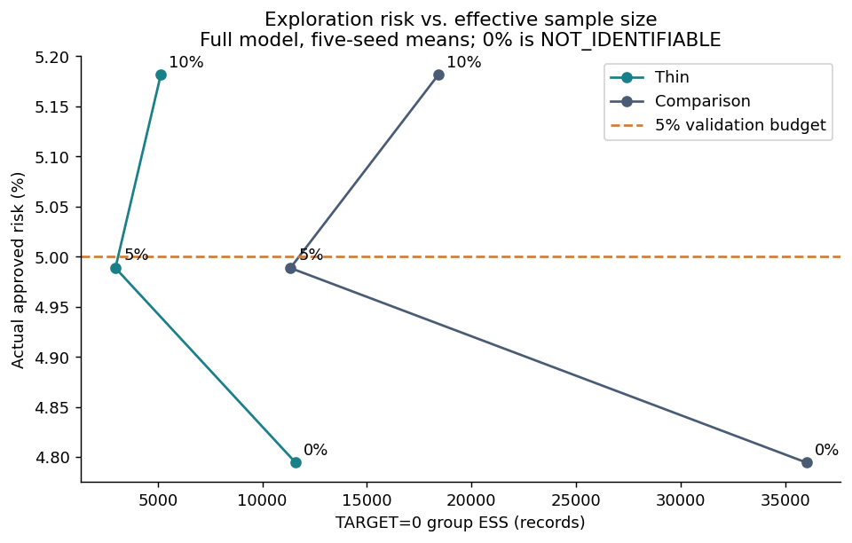

# 公平性研究扩展 V2：结果与科学分析

本轮真实 Home Credit 实验已完成，运行状态 PASS；独立复核 3707 项通过。恢复6个固定评分模型，比较78行后处理策略，生成180行组别估计与90个探索回放。旧文件全部哈希一致。这里只在当前历史人群和冻结模型下评价，不构成真实机构歧视判断或风险保证。

## 证据分层

历史audit_extension的220模型、701行、9768检查由发布物核对，逐条历史台账未发布，本机没有重新执行那9768项。本轮仅恢复6个200树模型，保留新模型、分数、规则、记录和独立核验。原始400树审批结果与本轮不直接相减。全部新策略冻结后才进行测试评价，历史测试已被查看。

## P0：固定分数下联合约束

主epsilon=2pp、delta=1pp。两侧保护参照同模型、同双阈值空间的业务解。所有策略共享512网格精度、相同候选哈希和破同分规则（批准人数、风险、差距、阈值索引）。相同分数在同组内不分割。风险预算为验证获批TARGET1比例5%，最少500批准。最优性只指有限网格。验证可行不等于测试达标，CSV逐项记录测试风险、gap及两组no-harm违规。

完整数据固定模型：
- Business Group：FRR thin=20.15%，comparison=14.32%；差距=5.83pp；批准=81.29%；风险=4.79%。
- Fair Gap Only：FRR thin=16.14%，comparison=16.05%；差距=0.09pp；批准=81.03%；风险=4.79%。
- Fair Gap + No-Harm：INFEASIBLE；不存在同时满足三项冻结约束与最少批准人数的网格解，不输出批准指标。

全部六模型的主对照，百分率为%，gap为pp：

| model | policy | status | thin FRR % | comparison FRR % | gap pp | approval % | risk % | AUC | NH changes gap rule | NH removed candidates |
|---|---|---|---|---|---|---|---|---|---|---|
| full | business | PASS | 20.148 | 14.316 | 5.832 | 81.289 | 4.794 | 0.76738 | NA | 0 |
| full | gap_e0.02 | PASS | 16.143 | 16.053 | 0.09 | 81.029 | 4.788 | 0.76738 | NA | 0 |
| full | noharm_e0.02_d0.01 | INFEASIBLE | NA | NA | NA | NA | NA | NA | True | 8032 |
| r50_s17_biased | business | PASS | 20.885 | 14.64 | 6.245 | 80.845 | 4.76 | 0.75724 | NA | 0 |
| r50_s17_biased | gap_e0.02 | PASS | 17.432 | 15.732 | 1.7 | 80.928 | 4.774 | 0.75724 | NA | 0 |
| r50_s17_biased | noharm_e0.02_d0.01 | INFEASIBLE | NA | NA | NA | NA | NA | NA | True | 7979 |
| r50_s29_biased | business | PASS | 15.233 | 15.979 | 0.746 | 81.342 | 4.829 | 0.75829 | NA | 0 |
| r50_s29_biased | gap_e0.02 | PASS | 15.233 | 15.979 | 0.746 | 81.342 | 4.829 | 0.75829 | NA | 0 |
| r50_s29_biased | noharm_e0.02_d0.01 | PASS | 15.233 | 15.979 | 0.746 | 81.342 | 4.829 | 0.75829 | False | 7987 |
| r50_s43_biased | business | PASS | 16.419 | 15.615 | 0.803 | 81.303 | 4.822 | 0.75743 | NA | 0 |
| r50_s43_biased | gap_e0.02 | PASS | 16.419 | 15.615 | 0.803 | 81.303 | 4.822 | 0.75743 | NA | 0 |
| r50_s43_biased | noharm_e0.02_d0.01 | PASS | 16.419 | 15.615 | 0.803 | 81.303 | 4.822 | 0.75743 | False | 7962 |
| r50_s61_biased | business | PASS | 20.327 | 14.361 | 5.966 | 81.216 | 4.799 | 0.75736 | NA | 0 |
| r50_s61_biased | gap_e0.02 | PASS | 16.722 | 15.651 | 1.071 | 81.222 | 4.844 | 0.75736 | NA | 0 |
| r50_s61_biased | noharm_e0.02_d0.01 | INFEASIBLE | NA | NA | NA | NA | NA | NA | True | 7993 |
| r50_s89_biased | business | PASS | 16.274 | 16.115 | 0.159 | 80.941 | 4.775 | 0.75715 | NA | 0 |
| r50_s89_biased | gap_e0.02 | PASS | 16.274 | 16.115 | 0.159 | 80.941 | 4.775 | 0.75715 | NA | 0 |
| r50_s89_biased | noharm_e0.02_d0.01 | PASS | 16.274 | 16.115 | 0.159 | 80.941 | 4.775 | 0.75715 | False | 7932 |

所有预设参数共78行，INFEASIBLE=15。共有2个可行No-Harm配置改变gap-only选中规则；另有15个规则变为不可行，不能算作可执行改善。`noharm_removed_candidates`表示保护约束排除的候选数，`noharm_changes_gap_only`表示是否改变最优规则；候选被排除不意味着一定改变所选解。各约束余量在原表。若无解，thresholds为null，指标缺失；不以全拒策略替代。

全部不可行配置如下。每行在风险与gap约束下存在候选，但加入对应双侧保护后可行数为0，因此不是运行失败：

| model | policy | gap_feasible_candidates | final_feasible_candidates |
|---|---|---|---|
| full | noharm_e0.01_d0.00 | 3993 | 0 |
| full | noharm_e0.01_d0.01 | 3993 | 0 |
| full | noharm_e0.02_d0.00 | 8032 | 0 |
| full | noharm_e0.02_d0.01 | 8032 | 0 |
| full | noharm_e0.05_d0.00 | 20033 | 0 |
| r50_s17_biased | noharm_e0.01_d0.00 | 3959 | 0 |
| r50_s17_biased | noharm_e0.01_d0.01 | 3959 | 0 |
| r50_s17_biased | noharm_e0.02_d0.00 | 7979 | 0 |
| r50_s17_biased | noharm_e0.02_d0.01 | 7979 | 0 |
| r50_s17_biased | noharm_e0.05_d0.00 | 20006 | 0 |
| r50_s61_biased | noharm_e0.01_d0.00 | 3991 | 0 |
| r50_s61_biased | noharm_e0.01_d0.01 | 3991 | 0 |
| r50_s61_biased | noharm_e0.02_d0.00 | 7993 | 0 |
| r50_s61_biased | noharm_e0.02_d0.01 | 7993 | 0 |
| r50_s61_biased | noharm_e0.05_d0.00 | 20038 | 0 |

可行且真正改变gap-only规则的两个配置均为预设敏感性epsilon=5pp、delta=1pp（下表为比例），不能据测试选它们替代主配置：

| model | policy | approval_rate | thin_frr | thick_frr |
|---|---|---|---|---|
| r50_s17_biased | noharm_e0.05_d0.01 | 0.80897 | 0.18728 | 0.15318 |
| r50_s61_biased | noharm_e0.05_d0.01 | 0.8116 | 0.18459 | 0.15082 |

测试集风险超预算0行，两侧保护超出各自delta均0行；但有7行测试gap超过各自验证epsilon。以下保留所有超出，表中epsilon与gap为比例，不放宽定义：

| model | policy | epsilon | abs_frr_gap |
|---|---|---|---|
| full | gap_e0.05 | 0.05 | 0.05217 |
| full | noharm_e0.05_d0.01 | 0.05 | 0.05217 |
| full | noharm_e0.05_d0.02 | 0.05 | 0.05217 |
| r50_s17_biased | gap_e0.01 | 0.01 | 0.01431 |
| r50_s17_biased | noharm_e0.01_d0.02 | 0.01 | 0.01431 |
| r50_s61_biased | gap_e0.01 | 0.01 | 0.01071 |
| r50_s61_biased | noharm_e0.01_d0.02 | 0.01 | 0.01071 |

主配置下biased模型的可行子集均值（不是五个独立业务人群；可行数business/gap/no-harm分别为[5, 5, 3]，缺失配置不可拿来当作同五模型均值对照）：

| policy | thin_frr | thick_frr | abs_frr_gap | approval_rate | approved_risk |
|---|---|---|---|---|---|
| business | 17.827 | 15.342 | 2.784 | 81.129 | 4.797 |
| gap_e0.02 | 16.416 | 15.818 | 0.896 | 81.147 | 4.809 |
| noharm_e0.02_d0.01 | 15.975 | 15.903 | 0.57 | 81.195 | 4.809 |

为保持严格配对，以下三策略只在共同可行的seed29/43/89上计算相同三模型均值；结果完全一致。不能拿上面的3模型No-Harm均值减去5模型business均值归因：

| policy | thin_frr | thick_frr | abs_frr_gap | approval_rate | approved_risk |
|---|---|---|---|---|---|
| business | 15.975 | 15.903 | 0.57 | 81.195 | 4.809 |
| gap_e0.02 | 15.975 | 15.903 | 0.57 | 81.195 | 4.809 |
| noharm_e0.02_d0.01 | 15.975 | 15.903 | 0.57 | 81.195 | 4.809 |

风险、差距与保护是不同约束。No-Harm可缩小可行集，不能保证批准数增加；保护的是验证集整体群体FRR，不保护每个个体或每个子群。主结果若规则未改变则新约束没有额外决策效果，不能冒充方法收益。

## 条件性95%区间

下面为full模型主要指标的配对bootstrap区间，前两列为比例×100，difference区间为相对同模型business的变化pp；精确点差由COMPARISON_TABLES逐行相减。1000次同记录配对重采样，以联合单元multinomial实现，不重训不重选阈值。AUC的DeLong渐近95%区间另见auc_intervals.csv。全部模型/参数/子群的区间在paired_intervals.csv，不仅保存最佳配置。

| policy | metric | lo | hi | difference_lo | difference_hi |
|---|---|---|---|---|---|
| business | approval_rate | 80.978 | 81.583 | 0.0 | 0.0 |
| business | approved_risk | 4.62 | 4.976 | 0.0 | 0.0 |
| business | thick_frr | 13.984 | 14.65 | 0.0 | 0.0 |
| business | thin_frr | 19.56 | 20.792 | 0.0 | 0.0 |
| business | abs_frr_gap | 5.121 | 6.578 | 0.0 | 0.0 |
| gap_e0.02 | approval_rate | 80.723 | 81.331 | -0.377 | -0.132 |
| gap_e0.02 | approved_risk | 4.614 | 4.969 | -0.06 | 0.045 |
| gap_e0.02 | thick_frr | 15.697 | 16.39 | 1.603 | 1.85 |
| gap_e0.02 | thin_frr | 15.615 | 16.736 | -4.332 | -3.69 |
| gap_e0.02 | abs_frr_gap | 0.011 | 0.839 | -6.029 | -4.617 |

## P1：六个交叉子群

收入界仅原完整训练池拟合：[117000.0, 180000.0]，按原始收入单位。六交叉组n与TARGET0均≥100才标PASS。单组FRR用Wilson95%区间，变化用同记录配对bootstrap；所有区间未做多重比较校正。缺失组不填0。可行策略每模型至多18行，INFEASIBLE策略不生成子群决策；见subgroups.csv，所有六模型共90行。

最大的探索性子群FRR恶化为full、gap_e0.02、comparison/middle，变化+1.815pp。该交叉组变化的条件配对95%区间为[+1.601,+2.006]pp（未校正多重比较）；不能仅凭最大值声称普遍显著。

总体两组和内部六组同时报告。组均差距小并不蕴含收入交叉子群也受到保护。该有限审计借鉴Kearns等的研究动机，没有复现其对抗子群学习算法，也不把收入当作法律保护身份。

## P2：标签可见性与FRR估计

原反馈台账未发布，因此本轮是静态、独立的新回放，不是旧五轮闭环的复核。仅用各模型Business Group计划审批，拒绝者探索率0/5/10%，五seed共享嵌套uniform。plan无标签输入，先保存后揭示actual获批的成熟结果。IPW估计的拒绝是proposed_reject，探索者不能被误算为原策略批准。估计函数只接受observable ledger，Oracle是最终离线单独函数。

公式：sum_visible I(TARGET0)I(proposed_reject)/pi 除以 sum_visible I(TARGET0)/pi。pi=0的任何目标记录破坏正性，IPW结果为NOT_IDENTIFIABLE；本轮这类组别结果共60行。Naive在无探索时通常为0，这不表示真实FRR为0。记录FRR分母相关的TARGET0 ESS以及全部visible ESS、最大权重、覆盖率。0%探索的可见样本即使ESS很高也不具正性，不能把这个ESS误当作完整人群的信息量。归一化比率有限样本可能偏，单个种子也可能IPW更差。

full模型10%探索五seed均值（FRR为比例，ESS为记录数）：

| group | naive_frr | ipw_frr | oracle_frr | ess_good | coverage | max_weight |
|---|---|---|---|---|---|---|
| 0 | 0.01633 | 0.14239 | 0.14316 | 18407.72222 | 0.84585 | 10.0 |
| 1 | 0.02488 | 0.20328 | 0.20148 | 5139.31824 | 0.79086 | 10.0 |

完整每模型、seed、rate、group和误差95%区间见ipw_estimates.csv。误差bootstrap仅在最终离线评估阶段将oracle与估计配对重采样，oracle不进入估计输入。五seed范围表示同一人群随机探索波动，不能写成五独立现实场景。识别条件包括正确记录倾向、正性、随机探索与成熟机制正确、稳定标签回放及足够ESS。

## P3：探索风险与信息成本

以下为full模型五seed均值，风险为比例，人数为记录数：

| exploration_rate | regular_n | regular_risk | exploration_n | exploration_risk | actual_n | actual_risk |
|---|---|---|---|---|---|---|
| 0.0 | 49995.0 | 0.04794 | 0.0 | NA | 49995.0 | 0.04794 |
| 0.05 | 49995.0 | 0.04794 | 575.8 | 0.21839 | 50570.8 | 0.04989 |
| 0.1 | 49995.0 | 0.04794 | 1146.4 | 0.22038 | 51141.4 | 0.05181 |

整个预设回放共有42/90个实际批准风险超过5%，不能把常规5%经验预算写成探索后的系统保证。不同rate均保留，没有用测试结果挑选探索率。若显示ESS增加或误差减少，仍须同时看额外批准和观察风险。Budgeted Exploration为NOT_RUN，本轮不宣称完成共同预算下的探索选择。

## 新增价值与归因

本项目的贡献是可复核工程组合：同评分同决策空间的双侧保护，有限收入子群的损害检查，以及独立的FRR估计与探索成本审计。没有提出新公平理论，没有复现reductions或RL算法。论文思想与项目实现分别列于REFERENCES.md。P0不改变模型，P1不训练，P2估计可靠性，P3计入探索成本，因果归因不混用。

## 失败、无效与未执行

启动时缺少Path导入导致一次NameError，已修正，尚未训练时发生，日志attempt_01_startup_failure.log保留。macOS缺OpenMP从现有本机库补到项目虚拟环境。sklearn/NumPy在校准中发出浮点matmul RuntimeWarning，未隐藏，需结合calibration_numerics.json的独立元素级梯度检查解释。不可行、未生效、测试违规和负面结果全部保留。旧台账审计BLOCKED_NOT_RUN；可选Budgeted Exploration NOT_RUN；必需P0–P3新实验均已运行。

复现和全部命令见REPRODUCIBILITY_REPORT.md；边界见LIMITATIONS.md。当前为本地CPU验证，没有AWS部署、分布式训练或云端性能测试。
