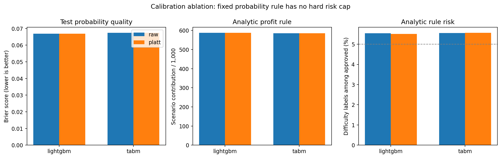
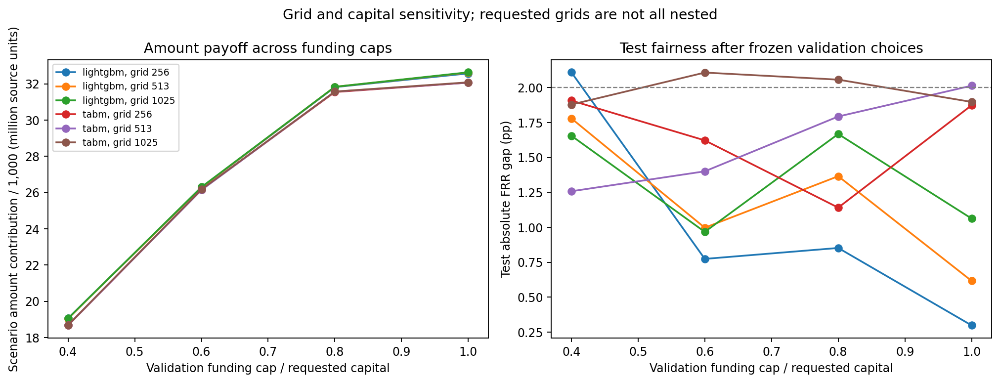

# 后续实验：强模型、公平成本与业务敏感性

本报告由已经保存的真实结果生成。run_001 是首轮基线，run_002 是事先排定的扩大调参和三种子复现。所有预测器参数由 reference 选择，Platt 参数由 calibration 拟合，审批阈值由 validation 选择后冻结；test 只重放。历史留出集此前已查看，不宣称新的盲测。

业务口径：单位净贡献=正常标签获批数−5×困难标签获批数；主风险预算5%，公平容差2个百分点，群体保护允许相对同模型无公平约束收益基准恶化最多1个百分点。TARGET=1 表示还款困难，金额与损失均为业务情景；金额单位保留数据原始单位。

## 统一人群下的模型比较

| run | model | seeds | auc_mean | auc_sd | brier_mean | reference_auc_mean |
| --- | --- | --- | --- | --- | --- | --- |
| run_001 | lightgbm | 3 | 0.77423 | 0.00028 | 0.06692 | 0.77224 |
| run_001 | logistic | 3 | 0.75554 | 0.00000 | 0.06795 | 0.75238 |
| run_001 | m2fgb | 3 | 0.72767 | 0.00000 | 0.06937 | 0.72100 |
| run_001 | m2fgb_tuned | 3 | 0.76784 | 0.00000 | 0.06725 | 0.76757 |
| run_001 | tabm | 3 | 0.76479 | 0.00056 | 0.06736 | 0.76054 |
| run_001 | xgboost | 3 | 0.76713 | 0.00024 | 0.06729 | 0.76398 |
| run_002 | lightgbm | 3 | 0.77498 | 0.00018 | 0.06685 | 0.77179 |
| run_002 | tabm | 3 | 0.76479 | 0.00056 | 0.06736 | 0.76054 |

模型使用同一划分和相同原始可用信息，处理方式遵循各模型适配。扩大调参的候选配置与 reference 分数保存在 run_002/tuning；表中列出真实表现，包括调参后没有改善的情况。论文方法在统一 Home Credit 场景的适配结果不能称为原论文所有基准复现，也不能据此宣称 SOTA。

## 同一业务口径的审批结果

| run | model | family | seeds | utility_per_1000 | approval_rate | risk | thin_frr | thick_frr | abs_frr_gap |
| --- | --- | --- | --- | --- | --- | --- | --- | --- | --- |
| run_001 | lightgbm | group_profit | 3 | 582.18298 | 0.82285 | 0.04875 | 0.18797 | 0.13490 | 0.05306 |
| run_001 | lightgbm | group_profit_gap | 3 | 581.22368 | 0.82186 | 0.04880 | 0.15679 | 0.14711 | 0.02110 |
| run_001 | lightgbm | group_profit_gap_noharm | 1 | 581.80902 | 0.82287 | 0.04883 | 0.16618 | 0.14249 | 0.02369 |
| run_001 | logistic | group_profit | 3 | 564.03753 | 0.79310 | 0.04814 | 0.21354 | 0.16679 | 0.04675 |
| run_001 | logistic | group_profit_gap | 3 | 560.89947 | 0.78986 | 0.04831 | 0.19465 | 0.17802 | 0.01664 |
| run_001 | logistic | group_profit_gap_noharm | 3 | 560.89947 | 0.78986 | 0.04831 | 0.19465 | 0.17802 | 0.01664 |
| run_001 | m2fgb | group_profit | 3 | 533.97395 | 0.74743 | 0.04760 | 0.26703 | 0.21135 | 0.05568 |
| run_001 | m2fgb | group_profit_gap | 3 | 533.87640 | 0.74772 | 0.04767 | 0.23663 | 0.22151 | 0.01512 |
| run_001 | m2fgb_tuned | group_profit | 3 | 578.39455 | 0.81263 | 0.04804 | 0.19913 | 0.14444 | 0.05469 |
| run_001 | m2fgb_tuned | group_profit_gap | 3 | 576.78487 | 0.80897 | 0.04784 | 0.17356 | 0.15813 | 0.01543 |
| run_001 | tabm | group_profit | 3 | 573.18071 | 0.80696 | 0.04828 | 0.23403 | 0.14058 | 0.09345 |
| run_001 | tabm | group_profit_gap | 3 | 572.22141 | 0.80304 | 0.04790 | 0.18220 | 0.16349 | 0.01871 |
| run_001 | tabm | group_profit_gap_noharm | 1 | 573.04522 | 0.80562 | 0.04811 | 0.17673 | 0.16203 | 0.01470 |
| run_001 | xgboost | group_profit | 3 | 578.61676 | 0.81435 | 0.04824 | 0.18190 | 0.14824 | 0.03366 |
| run_001 | xgboost | group_profit_gap | 3 | 578.16692 | 0.81276 | 0.04810 | 0.16825 | 0.15500 | 0.01325 |
| run_001 | xgboost | group_profit_gap_noharm | 2 | 577.69540 | 0.81310 | 0.04825 | 0.17208 | 0.15338 | 0.01870 |
| run_002 | lightgbm | group_profit | 3 | 582.75748 | 0.82180 | 0.04848 | 0.19502 | 0.13361 | 0.06141 |
| run_002 | lightgbm | group_profit_gap | 3 | 582.63283 | 0.81911 | 0.04812 | 0.15582 | 0.15046 | 0.00537 |
| run_002 | lightgbm | group_profit_gap_noharm | 1 | 582.89840 | 0.82045 | 0.04826 | 0.15550 | 0.14887 | 0.00663 |
| run_002 | tabm | group_profit | 3 | 573.21865 | 0.80696 | 0.04828 | 0.23401 | 0.14057 | 0.09343 |
| run_002 | tabm | group_profit_gap | 3 | 572.21599 | 0.80303 | 0.04790 | 0.18222 | 0.16349 | 0.01873 |
| run_002 | tabm | group_profit_gap_noharm | 1 | 573.04522 | 0.80562 | 0.04811 | 0.17673 | 0.16203 | 0.01470 |

同模型、同种子 group_profit 与公平变体的配对结果见 analysis/comparison/matched_fairness_cost.csv。跨模型差异同时包含预测能力变化；收益应和放贷规模、风险、两组误拒变化共同解读。不可行策略保留在原表，不用可行均值掩盖缺失。

run_001 / lightgbm / group_profit_gap：3 个配对种子的平均净贡献变化 -59.00（-0.165%），薄信用记录组误拒率变化 -3.118 个百分点，对照组变化 +1.221 个百分点。

run_001 / lightgbm / group_profit_gap_noharm：1 个配对种子的平均净贡献变化 +0.00（+0.000%），薄信用记录组误拒率变化 +0.000 个百分点，对照组变化 +0.000 个百分点。

run_001 / logistic / group_profit_gap：3 个配对种子的平均净贡献变化 -193.00（-0.556%），薄信用记录组误拒率变化 -1.889 个百分点，对照组变化 +1.123 个百分点。

run_001 / logistic / group_profit_gap_noharm：3 个配对种子的平均净贡献变化 -193.00（-0.556%），薄信用记录组误拒率变化 -1.889 个百分点，对照组变化 +1.123 个百分点。

run_001 / m2fgb / group_profit_gap：3 个配对种子的平均净贡献变化 -6.00（-0.018%），薄信用记录组误拒率变化 -3.040 个百分点，对照组变化 +1.016 个百分点。

run_001 / m2fgb_tuned / group_profit_gap：3 个配对种子的平均净贡献变化 -99.00（-0.278%），薄信用记录组误拒率变化 -2.557 个百分点，对照组变化 +1.368 个百分点。

run_001 / tabm / group_profit_gap：3 个配对种子的平均净贡献变化 -59.00（-0.167%），薄信用记录组误拒率变化 -5.183 个百分点，对照组变化 +2.290 个百分点。

run_001 / tabm / group_profit_gap_noharm：1 个配对种子的平均净贡献变化 +0.00（+0.000%），薄信用记录组误拒率变化 +0.000 个百分点，对照组变化 +0.000 个百分点。

run_001 / xgboost / group_profit_gap：3 个配对种子的平均净贡献变化 -27.67（-0.078%），薄信用记录组误拒率变化 -1.365 个百分点，对照组变化 +0.676 个百分点。

run_001 / xgboost / group_profit_gap_noharm：2 个配对种子的平均净贡献变化 -7.50（-0.021%），薄信用记录组误拒率变化 -0.755 个百分点，对照组变化 +0.148 个百分点。

run_002 / lightgbm / group_profit_gap：3 个配对种子的平均净贡献变化 -7.67（-0.021%），薄信用记录组误拒率变化 -3.920 个百分点，对照组变化 +1.685 个百分点。

run_002 / lightgbm / group_profit_gap_noharm：1 个配对种子的平均净贡献变化 +0.00（+0.000%），薄信用记录组误拒率变化 +0.000 个百分点，对照组变化 +0.000 个百分点。

run_002 / tabm / group_profit_gap：3 个配对种子的平均净贡献变化 -61.67（-0.175%），薄信用记录组误拒率变化 -5.179 个百分点，对照组变化 +2.291 个百分点。

run_002 / tabm / group_profit_gap_noharm：1 个配对种子的平均净贡献变化 +0.00（+0.000%），薄信用记录组误拒率变化 +0.000 个百分点，对照组变化 +0.000 个百分点。

## 校准消融

raw 与 Platt 在 417 对可行的验证经验收益审批规则中，有 417 对测试审批完全相同。严格单调校准通常保留排序；在分位数候选与经验标签收益搜索中，出现零差异是合理结果。代码逐人比较决定并保留变化数量，没有把概率改善自动解释为业务改善。

另列解析期望收益规则 p≤1/(1+lambda)。该规则直接使用概率值，因此可以检验校准对业务决策的影响。解析规则没有施加5%风险预算，也没有资金或公平硬约束，不能直接当作已经满足相同风险要求的竞争方法。概率 Brier/log-loss/ECE 与解析规则风险、净贡献见 analysis/calibration_ablation/。

## 资金与网格敏感性

固定模型分数后，在256、513、1025三个请求网格和100%/80%/60%/40%请求本金预算下重做验证优化；513网格另外执行风险3%/5%/8%与损失比3/5/7/10的单因素实验。网格不全嵌套，不能声称网格变密必然单调改进。验证冻结策略和测试逐策略数据分别保存。

资金/网格分析共 690 条策略记录，其中 70 条不可行。验证条件满足并不保证测试条件满足；测试风险、资金、公平和群体保护的结果均保留在 CSV。

run_001 主比较表：43 条可行记录；测试风险超预算 0 条；带公平要求的记录中测试差距超容差 6 条。

run_002 主比较表：14 条可行记录；测试风险超预算 0 条；带公平要求的记录中测试差距超容差 1 条。

强模型偏见压力测试另有 1380 条策略记录，位于 bias_stress/；采样种子与模型种子是不同变量，应结合其任务元数据解释。该部分考察原始选择偏差及修正方式在较强预测器上的迁移情况。

## 可用于汇报的结论组织

先用训练数据实验解释偏见来源，再用同模型公平成本说明新增获批与新增误拒各贡献了多少净收益，最后比较强模型能否覆盖公平代价。优先展示收益—误拒差距前沿、放贷规模与风险、群体误拒变化。若方法没有超过强基线，按实际指标呈现其适用条件和权衡。

所有图区分验证选择与测试评价，图片来自实际 CSV；PNG/PDF、图源和校验信息保存于对应 figures/。本阶段不改写 run_001 结果。
