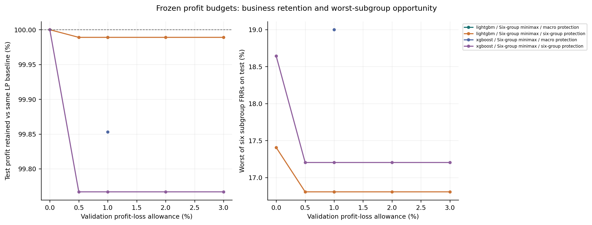
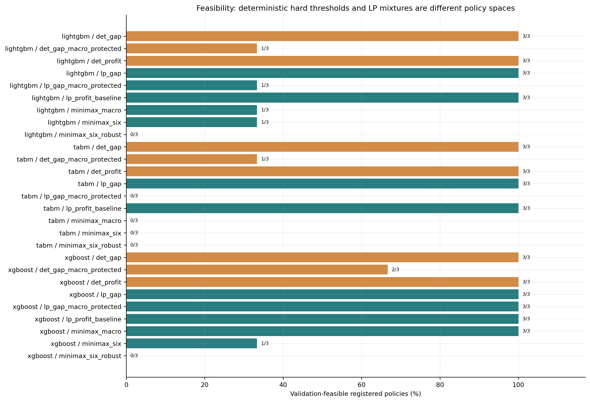
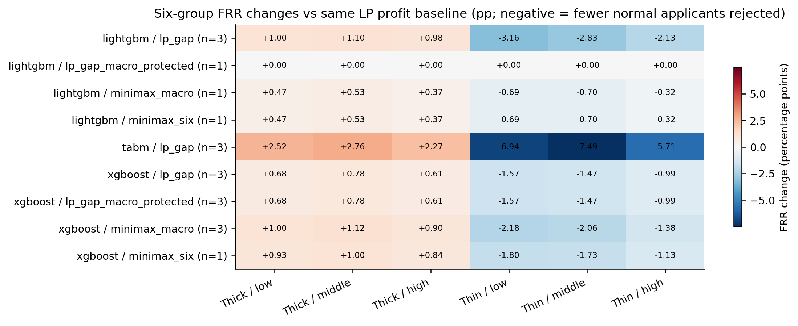
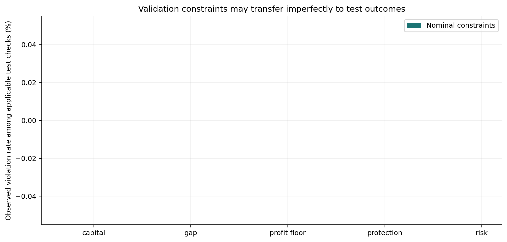
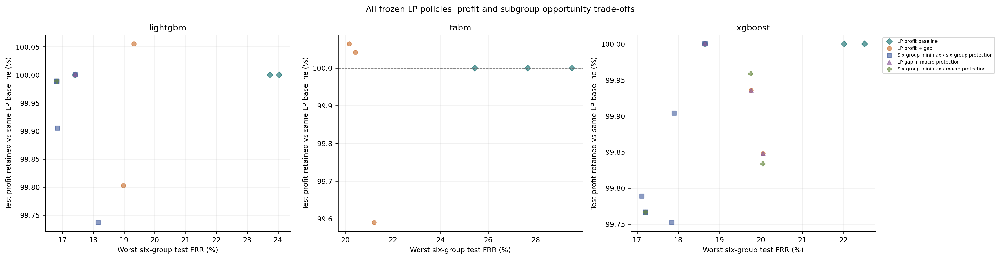

# 收益预算、群体保护与六子群最差误拒率：方法扩展实验

本报告只读取已冻结策略和测试重放结果。预测器保持原实验训练版本；新增内容是审批优化。本轮方法定位是课程项目中的业务、公平与群体保护联合设计，不宣称提出新的 SOTA 算法。

## 数据与比较口径

单位净贡献为正常标签获批数减去损失比乘以困难标签获批数；金额净贡献来自既定情景参数。TARGET=1 表示还款困难，指标不是实际银行账面利润。策略在 validation 上拟合后冻结；test 只重放。这个历史测试集曾被查看，不能称为新的盲测。

LP 策略对每个人给出获批概率，是单调分组阈值的随机混合。获批数、净贡献及误拒率表示期望值；风险是期望困难获批数除以期望总获批数，不是任一次随机执行都满足预算的保证。

原两组硬阈值与 LP 混合使用不同决策空间。LP 内的公平成本必须相对相同模型、种子、损失、风险与资金情景下的 LP 无公平约束收益基准计算；不能把决策空间和阈值网格变化带来的差异计作公平方法的单独贡献。

鲁棒变体在按申请 ID 固定分成的两个验证子集上同时施加相应约束。这是有限的验证稳定性检查，不是分布无关保证；下表保留测试超限情况。

主设置：风险预算 5%，公平容差 2 个百分点，原始严格保护目标 1 个百分点，收益预算 1%。自适应方法的有效保护上限由验证 LP 计算并另外报告，不能自动解释为满足原严格目标。

## 覆盖与可行性

登记需要的模型任务：24；表中已出现：24；缺失：无。

预设的严格六子群保护主方法，在 9 个完整数据模型/种子任务中只有 2 个验证可行。双折约束变体为 0/9 可行。因此，‘同时满足全部严格要求’尚未普遍实现；不能只展示少数可行种子。这些冲突为后续计算最低必要保护松弛提供了直接依据。

| experiment | model | policy_id | robust | registered | feasible | infeasible |
| --- | --- | --- | --- | --- | --- | --- |
| main | lightgbm | det_gap | 0 | 3 | 3 | 0 |
| main | lightgbm | det_gap_macro_protected | 0 | 3 | 1 | 2 |
| main | lightgbm | det_profit | 0 | 3 | 3 | 0 |
| main | lightgbm | lp_gap | 0 | 3 | 3 | 0 |
| main | lightgbm | lp_gap_macro_protected | 0 | 3 | 1 | 2 |
| main | lightgbm | lp_profit_baseline | 0 | 3 | 3 | 0 |
| main | lightgbm | minimax_macro | 0 | 3 | 1 | 2 |
| main | lightgbm | minimax_six | 0 | 3 | 1 | 2 |
| main | lightgbm | minimax_six_beta_0 | 0 | 3 | 1 | 2 |
| main | lightgbm | minimax_six_beta_0.005 | 0 | 3 | 1 | 2 |
| main | lightgbm | minimax_six_beta_0.02 | 0 | 3 | 1 | 2 |
| main | lightgbm | minimax_six_beta_0.03 | 0 | 3 | 1 | 2 |
| main | lightgbm | minimax_six_delta_0 | 0 | 3 | 1 | 2 |
| main | lightgbm | minimax_six_delta_0.02 | 0 | 3 | 2 | 1 |
| main | lightgbm | minimax_six_epsilon_0.01 | 0 | 3 | 1 | 2 |
| main | lightgbm | minimax_six_robust | 1 | 3 | 0 | 3 |
| main | tabm | det_gap | 0 | 3 | 3 | 0 |
| main | tabm | det_gap_macro_protected | 0 | 3 | 1 | 2 |
| main | tabm | det_profit | 0 | 3 | 3 | 0 |
| main | tabm | lp_gap | 0 | 3 | 3 | 0 |
| main | tabm | lp_gap_macro_protected | 0 | 3 | 0 | 3 |
| main | tabm | lp_profit_baseline | 0 | 3 | 3 | 0 |
| main | tabm | minimax_macro | 0 | 3 | 0 | 3 |
| main | tabm | minimax_six | 0 | 3 | 0 | 3 |
| main | tabm | minimax_six_beta_0 | 0 | 3 | 0 | 3 |
| main | tabm | minimax_six_beta_0.005 | 0 | 3 | 0 | 3 |
| main | tabm | minimax_six_beta_0.02 | 0 | 3 | 0 | 3 |
| main | tabm | minimax_six_beta_0.03 | 0 | 3 | 0 | 3 |
| main | tabm | minimax_six_delta_0 | 0 | 3 | 0 | 3 |
| main | tabm | minimax_six_delta_0.02 | 0 | 3 | 0 | 3 |
| main | tabm | minimax_six_epsilon_0.01 | 0 | 3 | 0 | 3 |
| main | tabm | minimax_six_robust | 1 | 3 | 0 | 3 |
| main | xgboost | det_gap | 0 | 3 | 3 | 0 |
| main | xgboost | det_gap_macro_protected | 0 | 3 | 2 | 1 |
| main | xgboost | det_profit | 0 | 3 | 3 | 0 |
| main | xgboost | lp_gap | 0 | 3 | 3 | 0 |
| main | xgboost | lp_gap_macro_protected | 0 | 3 | 3 | 0 |
| main | xgboost | lp_profit_baseline | 0 | 3 | 3 | 0 |
| main | xgboost | minimax_macro | 0 | 3 | 3 | 0 |
| main | xgboost | minimax_six | 0 | 3 | 1 | 2 |
| main | xgboost | minimax_six_beta_0 | 0 | 3 | 1 | 2 |
| main | xgboost | minimax_six_beta_0.005 | 0 | 3 | 1 | 2 |
| main | xgboost | minimax_six_beta_0.02 | 0 | 3 | 1 | 2 |
| main | xgboost | minimax_six_beta_0.03 | 0 | 3 | 1 | 2 |
| main | xgboost | minimax_six_delta_0 | 0 | 3 | 1 | 2 |
| main | xgboost | minimax_six_delta_0.02 | 0 | 3 | 3 | 0 |
| main | xgboost | minimax_six_epsilon_0.01 | 0 | 3 | 1 | 2 |
| main | xgboost | minimax_six_robust | 1 | 3 | 0 | 3 |
| stress | lightgbm_biased | det_gap | 0 | 5 | 5 | 0 |
| stress | lightgbm_biased | det_gap_macro_protected | 0 | 5 | 4 | 1 |
| stress | lightgbm_biased | det_profit | 0 | 5 | 5 | 0 |
| stress | lightgbm_biased | lp_gap | 0 | 5 | 5 | 0 |
| stress | lightgbm_biased | lp_gap_macro_protected | 0 | 5 | 4 | 1 |
| stress | lightgbm_biased | lp_profit_baseline | 0 | 5 | 5 | 0 |
| stress | lightgbm_biased | minimax_macro | 0 | 5 | 4 | 1 |
| stress | lightgbm_biased | minimax_six | 0 | 5 | 4 | 1 |
| stress | lightgbm_biased | minimax_six_robust | 1 | 5 | 0 | 5 |
| stress | lightgbm_corrected | det_gap | 0 | 5 | 5 | 0 |
| stress | lightgbm_corrected | det_gap_macro_protected | 0 | 5 | 4 | 1 |
| stress | lightgbm_corrected | det_profit | 0 | 5 | 5 | 0 |
| stress | lightgbm_corrected | lp_gap | 0 | 5 | 5 | 0 |
| stress | lightgbm_corrected | lp_gap_macro_protected | 0 | 5 | 4 | 1 |
| stress | lightgbm_corrected | lp_profit_baseline | 0 | 5 | 5 | 0 |
| stress | lightgbm_corrected | minimax_macro | 0 | 5 | 4 | 1 |
| stress | lightgbm_corrected | minimax_six | 0 | 5 | 4 | 1 |
| stress | lightgbm_corrected | minimax_six_robust | 1 | 5 | 0 | 5 |
| stress | lightgbm_opportunity1 | det_gap | 0 | 5 | 5 | 0 |
| stress | lightgbm_opportunity1 | det_gap_macro_protected | 0 | 5 | 2 | 3 |
| stress | lightgbm_opportunity1 | det_profit | 0 | 5 | 5 | 0 |
| stress | lightgbm_opportunity1 | lp_gap | 0 | 5 | 5 | 0 |
| stress | lightgbm_opportunity1 | lp_gap_macro_protected | 0 | 5 | 4 | 1 |
| stress | lightgbm_opportunity1 | lp_profit_baseline | 0 | 5 | 5 | 0 |
| stress | lightgbm_opportunity1 | minimax_macro | 0 | 5 | 4 | 1 |
| stress | lightgbm_opportunity1 | minimax_six | 0 | 5 | 4 | 1 |
| stress | lightgbm_opportunity1 | minimax_six_robust | 1 | 5 | 0 | 5 |

不可行记录全部保留；可行记录的均值不能替代完整任务的通过率。

## 主设置的同空间业务对照

| model | method_role | robust | utility | test_profit_retention | approval_rate | risk | abs_frr_gap | thin_frr | thick_frr | worst_subgroup_frr | utility_change_vs_lp | thin_frr_change_pp | thick_frr_change_pp | worst_subgroup_frr_change_pp | feasible_rows |
| --- | --- | --- | --- | --- | --- | --- | --- | --- | --- | --- | --- | --- | --- | --- | --- |
| lightgbm | lp_gap | 0.0000 | 35809.4312 | 0.9995 | 0.8227 | 0.0487 | 0.0156 | 0.1602 | 0.1446 | 0.1857 | -17.0085 | -2.7970 | 1.0307 | -3.1605 | 3.0000 |
| lightgbm | lp_gap_macro_protected | 0.0000 | 35813.3066 | 1.0000 | 0.8230 | 0.0487 | 0.0032 | 0.1507 | 0.1476 | 0.1741 | 0.0000 | 0.0000 | 0.0000 | 0.0000 | 1.0000 |
| lightgbm | lp_profit_baseline | 0.0000 | 35826.4397 | 1.0000 | 0.8232 | 0.0487 | 0.0539 | 0.1882 | 0.1343 | 0.2173 | 0.0000 | 0.0000 | 0.0000 | 0.0000 | 3.0000 |
| lightgbm | minimax_macro | 0.0000 | 35809.3752 | 0.9999 | 0.8209 | 0.0485 | 0.0075 | 0.1447 | 0.1522 | 0.1681 | -3.9314 | -0.6056 | 0.4596 | -0.5995 | 1.0000 |
| lightgbm | minimax_six | 0.0000 | 35809.3752 | 0.9999 | 0.8209 | 0.0485 | 0.0075 | 0.1447 | 0.1522 | 0.1681 | -3.9314 | -0.6056 | 0.4596 | -0.5995 | 1.0000 |
| tabm | lp_gap | 0.0000 | 35239.1906 | 0.9990 | 0.8068 | 0.0483 | 0.0247 | 0.1831 | 0.1584 | 0.2059 | -35.9214 | -6.8362 | 2.5303 | -6.9404 | 3.0000 |
| tabm | lp_profit_baseline | 0.0000 | 35275.1119 | 1.0000 | 0.8081 | 0.0484 | 0.1184 | 0.2515 | 0.1331 | 0.2753 | 0.0000 | 0.0000 | 0.0000 | 0.0000 | 3.0000 |
| xgboost | lp_gap | 0.0000 | 35597.0294 | 0.9993 | 0.8177 | 0.0487 | 0.0213 | 0.1696 | 0.1483 | 0.1948 | -25.6699 | -1.3949 | 0.6958 | -1.5687 | 3.0000 |
| xgboost | lp_gap_macro_protected | 0.0000 | 35597.0294 | 0.9993 | 0.8177 | 0.0487 | 0.0213 | 0.1696 | 0.1483 | 0.1948 | -25.6699 | -1.3949 | 0.6958 | -1.5687 | 3.0000 |
| xgboost | lp_profit_baseline | 0.0000 | 35622.6993 | 1.0000 | 0.8194 | 0.0489 | 0.0422 | 0.1835 | 0.1414 | 0.2105 | 0.0000 | 0.0000 | 0.0000 | 0.0000 | 3.0000 |
| xgboost | minimax_macro | 0.0000 | 35570.3875 | 0.9985 | 0.8168 | 0.0487 | 0.0186 | 0.1641 | 0.1514 | 0.1900 | -52.3118 | -1.9428 | 1.0095 | -2.0542 | 3.0000 |
| xgboost | minimax_six | 0.0000 | 35613.8256 | 0.9977 | 0.8188 | 0.0488 | 0.0089 | 0.1461 | 0.1550 | 0.1720 | -83.2130 | -1.6126 | 0.9264 | -1.4388 | 1.0000 |

收益保持率使用测试重放的收益除以同模型 LP 基准的测试收益；收益预算约束是在验证集施加的。测试保持率高于 100% 或低于验证预算边界都作为观察结果呈现。只有正基准收益才计算比例。

## 决策空间与可行性

| model | method_role | decision_family | feasible | registered |
| --- | --- | --- | --- | --- |
| lightgbm | det_gap | deterministic_two_thresholds | 3 | 3 |
| lightgbm | det_gap_macro_protected | deterministic_two_thresholds | 1 | 3 |
| lightgbm | det_profit | deterministic_two_thresholds | 3 | 3 |
| lightgbm | lp_gap | group_threshold_mixture | 3 | 3 |
| lightgbm | lp_gap_macro_protected | group_threshold_mixture | 1 | 3 |
| lightgbm | lp_profit_baseline | group_threshold_mixture | 3 | 3 |
| lightgbm | minimax_macro | group_threshold_mixture | 1 | 3 |
| lightgbm | minimax_six | group_threshold_mixture | 1 | 3 |
| lightgbm | minimax_six_robust | group_threshold_mixture | 0 | 3 |
| tabm | det_gap | deterministic_two_thresholds | 3 | 3 |
| tabm | det_gap_macro_protected | deterministic_two_thresholds | 1 | 3 |
| tabm | det_profit | deterministic_two_thresholds | 3 | 3 |
| tabm | lp_gap | group_threshold_mixture | 3 | 3 |
| tabm | lp_gap_macro_protected | group_threshold_mixture | 0 | 3 |
| tabm | lp_profit_baseline | group_threshold_mixture | 3 | 3 |
| tabm | minimax_macro | group_threshold_mixture | 0 | 3 |
| tabm | minimax_six | group_threshold_mixture | 0 | 3 |
| tabm | minimax_six_robust | group_threshold_mixture | 0 | 3 |
| xgboost | det_gap | deterministic_two_thresholds | 3 | 3 |
| xgboost | det_gap_macro_protected | deterministic_two_thresholds | 2 | 3 |
| xgboost | det_profit | deterministic_two_thresholds | 3 | 3 |
| xgboost | lp_gap | group_threshold_mixture | 3 | 3 |
| xgboost | lp_gap_macro_protected | group_threshold_mixture | 3 | 3 |
| xgboost | lp_profit_baseline | group_threshold_mixture | 3 | 3 |
| xgboost | minimax_macro | group_threshold_mixture | 3 | 3 |
| xgboost | minimax_six | group_threshold_mixture | 1 | 3 |
| xgboost | minimax_six_robust | group_threshold_mixture | 0 | 3 |

可行性提升需要同时查看决策空间变化与约束差异；不能仅凭 LP 更易可行就声称算法全面优于硬阈值。

## 六个子群的机会变化

| model | method_role | robust | subgroup_0_0_frr_change_pp | subgroup_0_1_frr_change_pp | subgroup_0_2_frr_change_pp | subgroup_1_0_frr_change_pp | subgroup_1_1_frr_change_pp | subgroup_1_2_frr_change_pp |
| --- | --- | --- | --- | --- | --- | --- | --- | --- |
| lightgbm | lp_gap | 0.0000 | 1.0004 | 1.1010 | 0.9786 | -3.1605 | -2.8313 | -2.1340 |
| lightgbm | lp_gap_macro_protected | 0.0000 | 0.0000 | 0.0000 | 0.0000 | 0.0000 | 0.0000 | 0.0000 |
| lightgbm | minimax_macro | 0.0000 | 0.4670 | 0.5285 | 0.3732 | -0.6886 | -0.7023 | -0.3249 |
| lightgbm | minimax_six | 0.0000 | 0.4670 | 0.5285 | 0.3732 | -0.6886 | -0.7023 | -0.3249 |
| tabm | lp_gap | 0.0000 | 2.5243 | 2.7600 | 2.2710 | -6.9404 | -7.4854 | -5.7149 |
| xgboost | lp_gap | 0.0000 | 0.6793 | 0.7808 | 0.6136 | -1.5687 | -1.4728 | -0.9881 |
| xgboost | lp_gap_macro_protected | 0.0000 | 0.6793 | 0.7808 | 0.6136 | -1.5687 | -1.4728 | -0.9881 |
| xgboost | minimax_macro | 0.0000 | 0.9956 | 1.1182 | 0.8974 | -2.1750 | -2.0583 | -1.3829 |
| xgboost | minimax_six | 0.0000 | 0.9339 | 0.9964 | 0.8387 | -1.8014 | -1.7259 | -1.1292 |

负值表示相对同空间收益基准少拒绝正常标签客户；正值表示增加。收入分组只用于目标与审计，审批概率仍来自信用记录组内单调的分数阈值混合。

## 验证约束在测试集的迁移

| model | method_role | robust | beta | constraint | evaluated | violations | violation_rate |
| --- | --- | --- | --- | --- | --- | --- | --- |
| lightgbm | lp_profit_baseline | 0.0000 | NA | risk | 3.0000 | 0.0000 | 0.0000 |
| lightgbm | lp_profit_baseline | 0.0000 | NA | capital | 3.0000 | 0.0000 | 0.0000 |
| lightgbm | lp_gap | 0.0000 | NA | risk | 3.0000 | 0.0000 | 0.0000 |
| lightgbm | lp_gap | 0.0000 | NA | capital | 3.0000 | 0.0000 | 0.0000 |
| lightgbm | lp_gap | 0.0000 | NA | gap | 3.0000 | 2.0000 | 0.6667 |
| lightgbm | det_profit | 0.0000 | NA | risk | 3.0000 | 0.0000 | 0.0000 |
| lightgbm | det_profit | 0.0000 | NA | capital | 3.0000 | 0.0000 | 0.0000 |
| lightgbm | det_gap | 0.0000 | NA | risk | 3.0000 | 0.0000 | 0.0000 |
| lightgbm | det_gap | 0.0000 | NA | capital | 3.0000 | 0.0000 | 0.0000 |
| lightgbm | lp_gap_macro_protected | 0.0000 | NA | risk | 1.0000 | 0.0000 | 0.0000 |
| lightgbm | lp_gap_macro_protected | 0.0000 | NA | capital | 1.0000 | 0.0000 | 0.0000 |
| lightgbm | lp_gap_macro_protected | 0.0000 | NA | gap | 1.0000 | 0.0000 | 0.0000 |
| lightgbm | lp_gap_macro_protected | 0.0000 | NA | protection | 1.0000 | 0.0000 | 0.0000 |
| lightgbm | minimax_macro | 0.0000 | 0.0100 | risk | 1.0000 | 0.0000 | 0.0000 |
| lightgbm | minimax_macro | 0.0000 | 0.0100 | capital | 1.0000 | 0.0000 | 0.0000 |
| lightgbm | minimax_macro | 0.0000 | 0.0100 | gap | 1.0000 | 0.0000 | 0.0000 |
| lightgbm | minimax_macro | 0.0000 | 0.0100 | protection | 1.0000 | 0.0000 | 0.0000 |
| lightgbm | minimax_macro | 0.0000 | 0.0100 | profit floor | 1.0000 | 0.0000 | 0.0000 |
| lightgbm | minimax_six | 0.0000 | 0.0100 | risk | 1.0000 | 0.0000 | 0.0000 |
| lightgbm | minimax_six | 0.0000 | 0.0100 | capital | 1.0000 | 0.0000 | 0.0000 |
| lightgbm | minimax_six | 0.0000 | 0.0100 | gap | 1.0000 | 0.0000 | 0.0000 |
| lightgbm | minimax_six | 0.0000 | 0.0100 | protection | 1.0000 | 0.0000 | 0.0000 |
| lightgbm | minimax_six | 0.0000 | 0.0100 | profit floor | 1.0000 | 0.0000 | 0.0000 |
| lightgbm | det_gap_macro_protected | 0.0000 | NA | risk | 1.0000 | 0.0000 | 0.0000 |
| lightgbm | det_gap_macro_protected | 0.0000 | NA | capital | 1.0000 | 0.0000 | 0.0000 |
| tabm | lp_profit_baseline | 0.0000 | NA | risk | 3.0000 | 0.0000 | 0.0000 |
| tabm | lp_profit_baseline | 0.0000 | NA | capital | 3.0000 | 0.0000 | 0.0000 |
| tabm | lp_gap | 0.0000 | NA | risk | 3.0000 | 0.0000 | 0.0000 |
| tabm | lp_gap | 0.0000 | NA | capital | 3.0000 | 0.0000 | 0.0000 |
| tabm | lp_gap | 0.0000 | NA | gap | 3.0000 | 3.0000 | 1.0000 |
| tabm | det_profit | 0.0000 | NA | risk | 3.0000 | 0.0000 | 0.0000 |
| tabm | det_profit | 0.0000 | NA | capital | 3.0000 | 0.0000 | 0.0000 |
| tabm | det_gap | 0.0000 | NA | risk | 3.0000 | 0.0000 | 0.0000 |
| tabm | det_gap | 0.0000 | NA | capital | 3.0000 | 0.0000 | 0.0000 |
| tabm | det_gap_macro_protected | 0.0000 | NA | risk | 1.0000 | 0.0000 | 0.0000 |
| tabm | det_gap_macro_protected | 0.0000 | NA | capital | 1.0000 | 0.0000 | 0.0000 |
| xgboost | lp_profit_baseline | 0.0000 | NA | risk | 3.0000 | 0.0000 | 0.0000 |
| xgboost | lp_profit_baseline | 0.0000 | NA | capital | 3.0000 | 0.0000 | 0.0000 |
| xgboost | lp_gap | 0.0000 | NA | risk | 3.0000 | 0.0000 | 0.0000 |
| xgboost | lp_gap | 0.0000 | NA | capital | 3.0000 | 0.0000 | 0.0000 |
| xgboost | lp_gap | 0.0000 | NA | gap | 3.0000 | 2.0000 | 0.6667 |
| xgboost | lp_gap_macro_protected | 0.0000 | NA | risk | 3.0000 | 0.0000 | 0.0000 |
| xgboost | lp_gap_macro_protected | 0.0000 | NA | capital | 3.0000 | 0.0000 | 0.0000 |
| xgboost | lp_gap_macro_protected | 0.0000 | NA | gap | 3.0000 | 2.0000 | 0.6667 |
| xgboost | lp_gap_macro_protected | 0.0000 | NA | protection | 3.0000 | 2.0000 | 0.6667 |
| xgboost | minimax_macro | 0.0000 | 0.0100 | risk | 3.0000 | 0.0000 | 0.0000 |
| xgboost | minimax_macro | 0.0000 | 0.0100 | capital | 3.0000 | 0.0000 | 0.0000 |
| xgboost | minimax_macro | 0.0000 | 0.0100 | gap | 3.0000 | 2.0000 | 0.6667 |
| xgboost | minimax_macro | 0.0000 | 0.0100 | protection | 3.0000 | 2.0000 | 0.6667 |
| xgboost | minimax_macro | 0.0000 | 0.0100 | profit floor | 3.0000 | 0.0000 | 0.0000 |
| xgboost | minimax_six | 0.0000 | 0.0100 | risk | 1.0000 | 0.0000 | 0.0000 |
| xgboost | minimax_six | 0.0000 | 0.0100 | capital | 1.0000 | 0.0000 | 0.0000 |
| xgboost | minimax_six | 0.0000 | 0.0100 | gap | 1.0000 | 0.0000 | 0.0000 |
| xgboost | minimax_six | 0.0000 | 0.0100 | protection | 1.0000 | 0.0000 | 0.0000 |
| xgboost | minimax_six | 0.0000 | 0.0100 | profit floor | 1.0000 | 0.0000 | 0.0000 |
| xgboost | det_profit | 0.0000 | NA | risk | 3.0000 | 0.0000 | 0.0000 |
| xgboost | det_profit | 0.0000 | NA | capital | 3.0000 | 0.0000 | 0.0000 |
| xgboost | det_gap | 0.0000 | NA | risk | 3.0000 | 0.0000 | 0.0000 |
| xgboost | det_gap | 0.0000 | NA | capital | 3.0000 | 0.0000 | 0.0000 |
| xgboost | det_gap_macro_protected | 0.0000 | NA | risk | 2.0000 | 0.0000 | 0.0000 |
| xgboost | det_gap_macro_protected | 0.0000 | NA | capital | 2.0000 | 0.0000 | 0.0000 |

每项只统计可行策略中适用且有记录的检查。名义与双折约束的任务构成可能不同，整体比例只作描述；应结合逐模型、逐方法的分母和不可行数量判断。

## 区间和随机执行的不确定性

`paired_intervals.csv` 中的区间是固定模型、固定审批规则下的申请人配对自助区间，反映样本重抽的不确定性；不能替代训练随机种子比较，也不能代表重新调参后的整体不确定性。`randomization_replays.csv` 另外反映逐申请人独立随机获批的一次实际执行波动。

| job | policy | repetitions | utility_mean | utility_sd | risk_mean | risk_sd | risk_met_rate | gap_met_rate | profit_floor_met_rate |
| --- | --- | --- | --- | --- | --- | --- | --- | --- | --- |
| lightgbm_s731 | lp_gap | 100.0000 | 35854.1300 | 37.4435 | 0.0485 | 0.0001 | 1.0000 | 0.0000 | 1.0000 |
| lightgbm_s732 | lp_gap | 100.0000 | 35772.5700 | 41.6976 | 0.0489 | 0.0001 | 1.0000 | 0.1500 | 1.0000 |
| lightgbm_s733 | lp_gap | 100.0000 | 35813.7900 | 54.3448 | 0.0487 | 0.0002 | 1.0000 | 1.0000 | 1.0000 |
| lightgbm_s733 | minimax_six | 100.0000 | 35810.7400 | 21.4498 | 0.0485 | 0.0001 | 1.0000 | 1.0000 | 1.0000 |
| tabm_s731 | lp_gap | 100.0000 | 35276.7500 | 40.8598 | 0.0482 | 0.0001 | 1.0000 | 0.0000 | 1.0000 |
| tabm_s732 | lp_gap | 100.0000 | 35199.4600 | 23.3794 | 0.0483 | 0.0001 | 1.0000 | 0.0000 | 1.0000 |
| tabm_s733 | lp_gap | 100.0000 | 35236.2800 | 38.4611 | 0.0484 | 0.0001 | 1.0000 | 0.0000 | 1.0000 |
| xgboost_s731 | lp_gap | 100.0000 | 35696.7000 | 17.4075 | 0.0489 | 0.0001 | 1.0000 | 1.0000 | 1.0000 |
| xgboost_s731 | minimax_six | 100.0000 | 35614.3300 | 34.5537 | 0.0488 | 0.0001 | 1.0000 | 1.0000 | 1.0000 |
| xgboost_s732 | lp_gap | 100.0000 | 35449.6800 | 51.0175 | 0.0488 | 0.0002 | 1.0000 | 0.0000 | 1.0000 |
| xgboost_s733 | lp_gap | 100.0000 | 35642.1700 | 31.5835 | 0.0484 | 0.0001 | 1.0000 | 0.0000 | 1.0000 |

满足比例来自保存的有限随机执行次数，只描述这些执行；它不是银行未来每一批贷款满足约束的保证。

## 偏差压力测试覆盖

| model | policy_id | robust | registered | feasible |
| --- | --- | --- | --- | --- |
| lightgbm_biased | det_gap | 0 | 5 | 5 |
| lightgbm_biased | det_gap_macro_protected | 0 | 5 | 4 |
| lightgbm_biased | det_profit | 0 | 5 | 5 |
| lightgbm_biased | lp_gap | 0 | 5 | 5 |
| lightgbm_biased | lp_gap_macro_protected | 0 | 5 | 4 |
| lightgbm_biased | lp_profit_baseline | 0 | 5 | 5 |
| lightgbm_biased | minimax_macro | 0 | 5 | 4 |
| lightgbm_biased | minimax_six | 0 | 5 | 4 |
| lightgbm_biased | minimax_six_robust | 1 | 5 | 0 |
| lightgbm_corrected | det_gap | 0 | 5 | 5 |
| lightgbm_corrected | det_gap_macro_protected | 0 | 5 | 4 |
| lightgbm_corrected | det_profit | 0 | 5 | 5 |
| lightgbm_corrected | lp_gap | 0 | 5 | 5 |
| lightgbm_corrected | lp_gap_macro_protected | 0 | 5 | 4 |
| lightgbm_corrected | lp_profit_baseline | 0 | 5 | 5 |
| lightgbm_corrected | minimax_macro | 0 | 5 | 4 |
| lightgbm_corrected | minimax_six | 0 | 5 | 4 |
| lightgbm_corrected | minimax_six_robust | 1 | 5 | 0 |
| lightgbm_opportunity1 | det_gap | 0 | 5 | 5 |
| lightgbm_opportunity1 | det_gap_macro_protected | 0 | 5 | 2 |
| lightgbm_opportunity1 | det_profit | 0 | 5 | 5 |
| lightgbm_opportunity1 | lp_gap | 0 | 5 | 5 |
| lightgbm_opportunity1 | lp_gap_macro_protected | 0 | 5 | 4 |
| lightgbm_opportunity1 | lp_profit_baseline | 0 | 5 | 5 |
| lightgbm_opportunity1 | minimax_macro | 0 | 5 | 4 |
| lightgbm_opportunity1 | minimax_six | 0 | 5 | 4 |
| lightgbm_opportunity1 | minimax_six_robust | 1 | 5 | 0 |

压力任务使用既定偏置数据训练得到的保存分数；本扩展只重做冻结审批优化。各偏差条件应配对同条件的 LP 基准，不能与完整数据基准混算收益成本。

## 方法结论应怎样写

本轮回答的是：在固定风险、资金与可容忍收益损失下，能否降低最不利子群的正常客户误拒率，以及代价由谁承担。六子群 minimax、收益下限和相对基准保护共同构成可解释的审批设计。

阈值混合、线性规划和 minimax 都是已有思想；课程贡献是把它们与当前 Home Credit 的偏差机制、透明收益情景和业务预算结合，并做同空间消融与测试超限审计。若某些保护条件不可行、测试收益低于预算或双折约束未改善迁移，保留结果并说明适用条件。

## 输出文件

- `policy_metrics.csv`：所有登记策略，包括不可行任务。
- `protected_matched_lp_baselines.csv`：同空间收益和机会变化的配对明细。
- `protected_test_constraints.csv`：逐方法测试约束超限次数与分母。
- `figures/protected_*.png/.pdf`：可用于汇报的真实结果图。
- `figure_data/protected_*.csv`：每张图的可追溯源记录。
- `protected_figure_manifest.json`：输入、脚本、配置和输出校验值。

